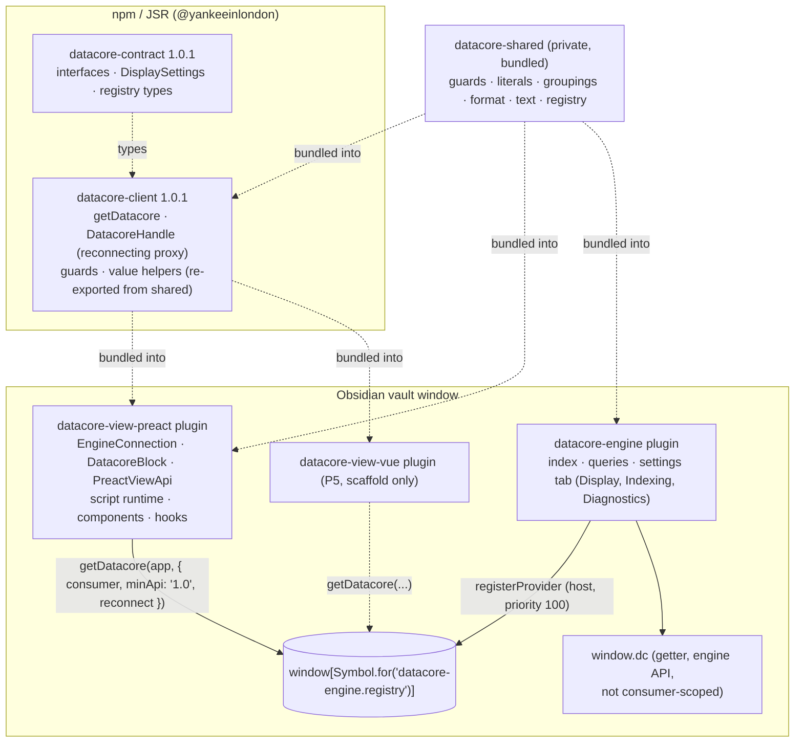

# Datacore View: Preact — Technical Reference

| | |
|---|---|
| **Package** | `@yankeeinlondon/datacore-view-preact` (`packages/view-preact`), plugin id `datacore-view-preact`, version 1.0.0 |
| **Status** | Shipped (P2, P2.1/P3); released via BRAT. Baseline for the Vue view layer (`datacore-view-vue`, P5) |
| **Audience** | Project owner and contributors designing `datacore-view-vue` |
| **Authority** | The source code. Docs that disagree with it are listed in [Appendix B](#appendix-b-discrepancies-between-docs-and-code) |
| **Related** | [Engine Room spec](../features/2026-11-08-engine-room/spec.md) (§7, §8, §9, §11.5, D9, D11), [P2 plan](../features/2026-11-08-engine-room/p2-plan.md), [P3 plan](../features/2026-11-08-engine-room/p3-plan.md) |

This document describes what the Preact view layer provides today, how it is wired to the engine through the client,
and where its views stop. Source references are given as `path:line` relative to `packages/view-preact/src/` unless a
full path is shown. Line numbers are those of `master` at the time of writing.

## Contents

1. [Overview](#1-overview)
2. [Architecture and integration](#2-architecture-and-integration)
3. [The script runtime and the `dc` local API](#3-the-script-runtime-and-the-dc-local-api)
4. [Renderers and components reference](#4-renderers-and-components-reference)
5. [Values and rendering rules](#5-values-and-rendering-rules)
6. [Error handling and loading](#6-error-handling-and-loading)
7. [Migration and coexistence](#7-migration-and-coexistence)
8. [Testing and quality](#8-testing-and-quality)
9. [Implications for the Vue view layer](#9-implications-for-the-vue-view-layer)
10. [Appendix A: file map](#appendix-a-file-map-of-packagesview-preactsrc) ·
    [Appendix B: discrepancies](#appendix-b-discrepancies-between-docs-and-code) ·
    [Appendix C: known bugs](#appendix-c-known-bugs)

## 1. Overview

`datacore-view-preact` ("Datacore View: Preact") is the Obsidian plugin that renders Datacore's script blocks with
Preact. It is upstream Datacore's UI, moved out of the engine in P2 and rebuilt as a consumer of
`@yankeeinlondon/datacore-client`.

**It owns:**

| Area | Where |
|---|---|
| Code block processors for `dc` (JS), `dct` (TS), `dcx` (JSX), `dctx` (TSX) | `main.ts:16`, `main.ts:66` |
| CodeMirror (legacy mode) highlighting for those languages, plus a rebuild of already-open notes | `main.ts:117`, `refresh.ts:26` |
| The script runtime: sucrase transpile, `new Function` evaluation, result-to-element conversion | `ui/scripting.ts`, `ui/javascript.tsx`, `ui/loading-boundary.tsx` |
| The script-facing `dc` object (`DatacoreLocalApi`): path-scoped contract API + hooks + components + `require` | `api/local-api.tsx` |
| `dc.require` script loading (`ScriptCache`) and host modules | `api/script-cache.ts`, `ui/scripting.ts:61` |
| Components: tables, lists, cards, callouts, layout, literals, links, embeds, form controls, paging | `api/ui/**`, `ui/markdown.tsx` |
| Hooks: `useQuery`, `useFullQuery`, `useFile`, `useIndexUpdates`, interning, controlled state | `ui/hooks.tsx`, `api/local-api.tsx:240` |
| The engine connection state machine and the "engine unavailable" notice | `connection.ts`, `block.ts` |
| A throttled file reader for embeds (`EmbedQueue`) | `ui/embed-queue.ts` |
| A Preact `options.vnode` hook that renders `DataArray` children | `ui/data-array-children.ts` |
| The command "Convert datacore code blocks to dc" | `migrate/**` |

**It does not own:** indexing, the query language, expression evaluation, persistence, `window.dc`, the reindex command,
or any settings. Those belong to `datacore-engine`. The plugin has **no settings tab**: display preferences (date
formats, `nullAs`, paging defaults, render depth) are read from the engine through `dc.settings.display`
(spec §8.2). `enableJs` was removed in P2; enabling the plugin is the opt-in to running scripts.

**Dependency rule (D9).** The only datacore packages it depends on are `@yankeeinlondon/datacore-client` and
`@yankeeinlondon/datacore-shared` (`packages/view-preact/package.json`); `@yankeeinlondon/datacore-contract` is a
dev dependency for types. Runtime dependencies: `preact`, `sucrase` (3.35.0), `builtin-modules`,
`@datastructures-js/queue`. luxon is type-only (`@types/luxon`); every luxon value comes from the engine
(`dc.luxon`). Two mechanisms enforce the boundary:

- pnpm isolation: an undeclared package (e.g. `@yankeeinlondon/datacore-engine`) does not resolve;
- oxlint `no-restricted-imports` for `packages/view-*/**` (`.oxlintrc.json`): blocks the path
  `@yankeeinlondon/datacore-engine` and the patterns `**/engine/**`, `**/packages/engine/**`.

The bundle is CommonJS, ES2018, built by esbuild from the workspace packages' TypeScript sources (`conditions:
["source"]`), with `obsidian`, `electron`, `@codemirror/*`, `@lezer/*` and Node built-ins external, and `react` /
`react-dom` aliased to `preact/compat` (`packages/view-preact/esbuild.config.mjs`). Imported CSS is emitted as
`styles.css`.

## 2. Architecture and integration

### 2.1 Layers



Inside a code block, scripts see the plugin's own path-scoped `dc` (section 3), which shadows the global `window.dc`.
The global exists for Templater/QuickAdd and the console; it is the bare engine API without hooks or components.

### 2.2 Plugin load (`main.ts:58`)

`DatacoreViewPreactPlugin.onload()` runs, in order:

1. `installDataArrayChildren()` (registered for removal on unload; section 2.10).
2. Creates one `EmbedQueue` (concurrency `() => 8`) as a child component (`main.ts:60`).
3. Creates `EngineConnection(app, this, { minApi: "1.0" })`, registers `connection.stop()`, and starts it without
   awaiting (`main.ts:62`).
4. For each language in `LANGUAGES` (`dc`→`js`, `dct`→`ts`, `dcx`→`jsx`, `dctx`→`tsx`), registers a code block
   processor at priority `-100`, unless the language is already taken (section 2.7).
5. Registers CodeMirror highlighting and, if `workspace.layoutReady`, rebuilds open notes that contain `dc*` fences
   (section 2.8).
6. Adds the command `convert-datacore-code-blocks` ("Convert datacore code blocks to dc").

Each processor callback does one thing: `context.addChild(new DatacoreBlock(element, connection, renderer, source,
context.sourcePath, scriptType))` (`main.ts:72`). The renderer closure is
`(engine, ...args) => this.view(engine, reader).renderScript(...args)`.

### 2.3 `EngineConnection` (`connection.ts:34`)

A small observable state machine around the client's `getDatacore()`:

```ts
type ConnectionState =
    | { status: "connecting" }
    | { status: "connected"; engine: DatacoreHandle }
    | { status: "unavailable"; reason: UnavailableReason; message: string };
// GetDatacoreFailure = "not-installed" | "disabled" | "incompatible" | "timeout"
type UnavailableReason = GetDatacoreFailure | "revoked";
```

- `start()` → `connect()` (`connection.ts:71`): sets `connecting`, then calls
  `getDatacore(app, { consumer: plugin, reconnect: true, minApi: "1.0", timeoutMs, host })`. `timeoutMs` is not set
  by `main.ts`, so the client default (10 000 ms) applies. A stale attempt counter discards late results.
- **Success** → `attach(engine)` (`connection.ts:92`): subscribes `engine.onRevoked` (→ `unavailable`/`revoked`,
  message "Datacore Engine stopped (it was disabled or is reloading).") and `engine.onReconnected` (→ `connected`
  with the same handle), then sets `connected`.
- **Failure** → `unavailable` with the client's reason and message, then `retryOnNextEngine()`
  (`connection.ts:105`): listens on the shared registry (`onProviderEvent` from `shared`) for the next `activated`
  event and calls `connect()` again. It does not poll, so an incompatible engine is not retried in a loop.
- `stop()` clears listeners and stops waiting. The client handle itself is released by the client when the plugin
  (the `consumer`) unloads.

The client side of reconnection (`packages/client/src/locate.ts:114`): the `DatacoreHandle` is a `Proxy` that
forwards to the active provider's `ScopedDatacore`. `subscribe`, `watchFile`, `onRevision` and `on` are tracked and
replayed onto the new connection when a provider activates again; other methods are bound to the current inner
handle. While disconnected, every call throws a `DatacoreError` with code `revoked`. An incompatible provider is never
attached. When the consumer unloads, the client calls `release()` on the engine handle (feature-checked), which
removes the plugin from the engine's Diagnostics list (P2 step 9).

### 2.4 `DatacoreBlock` lifecycle (`block.ts:24`)

`DatacoreBlock extends MarkdownRenderChild`. `onload()` renders once and re-renders on every
`connection.onChange`. `render()` (`block.ts:44`):

1. If a script child exists, remembers its current `path` (the renderer tracks renames), removes the child (which
   unmounts the Preact tree) and empties the container.
2. If `connected`: calls the renderer with `state.engine`, which returns a `DatacoreJSRenderer` child.
3. Otherwise: renders `div.datacore-engine-unavailable` with `is-connecting` or `is-unavailable` and the text from
   `unavailableMessage(state)` (`connection.ts:124`).

| State | Notice text |
|---|---|
| `connecting` | Waiting for Datacore Engine… |
| `not-installed` | This view needs the Datacore Engine plugin, which is not installed. |
| `disabled` | This view needs the Datacore Engine plugin. Enable it in Settings → Community plugins. |
| `revoked` | Datacore Engine is not running (it was disabled or is reloading). |
| `incompatible`, `timeout` | The client's message, e.g. "Datacore engine API 2.0.0 does not satisfy the required ^1.0." or "The Datacore engine did not become available within 10000 ms." |

Every transition (including a reconnect after an engine reload) tears the script down and runs it again against the
live engine. No note needs to be reopened.

### 2.5 `PreactViewApi`, one per handle (`api/api.ts:15`, `main.ts:107`)

The plugin keeps a `WeakMap<DatacoreHandle, PreactViewApi>`. Because the client handle survives engine reloads, in
practice there is one `PreactViewApi` per plugin load. It holds `services: ViewServices` (`ui/services.ts:10`):

| Service | Type | Meaning |
|---|---|---|
| `engine` | `DatacoreApi` (the plugin's `DatacoreHandle`) | Contract API only |
| `app` | `App` | Obsidian app: workspace, vault, metadata cache |
| `reader` | `EmbedQueue` | Throttled, de-duplicated file reads for embeds |

Members: `preact` (the module), `app`, `local(path)` → `new DatacoreLocalApi(this, path)`,
`renderScript(source, container, component, sourcePath, language)` (`api/api.ts:100`), and upstream's
`executeJs`/`executeJsx`/`executeTs`/`executeTsx` wrappers around `renderScript` (kept, not used by the plugin
itself). `renderScript` creates a new `DatacoreLocalApi` for the block, wraps it in a `DatacoreJSRenderer`, and adds
the renderer as a child of the given component.

### 2.6 Display settings flow

1. The user edits the **Display** group of the engine's settings tab
   (`packages/engine/src/settings-tab.ts:88`).
2. `DatacorePlugin.updateDisplay()` saves and calls `core.notifyDisplaySettings(copy)`
   (`packages/engine/src/main.ts:77`), which triggers the `display-settings` event.
3. `DatacoreJSRenderer` listens through the handle (`ui/javascript.tsx:59`) and calls `renderScript(renderer)` again.
4. That re-render passes `engine.settings.display` (a fresh copy on every access,
   `packages/engine/src/api/engine-api.ts:32`) into `SETTINGS_CONTEXT`. The script is **not** re-executed (the
   executor function is the same object), but every component that reads the context (`Lit`, `useDatacorePaging`)
   re-renders.

`DisplaySettings` (`packages/contract/src/settings.ts:7`) and the engine defaults
(`packages/engine/src/settings.ts:29`):

| Field | Default | Read by view-preact |
|---|---|---|
| `dateFormat` | `"MMMM dd, yyyy"` | `Lit` (dates without time) |
| `dateTimeFormat` | `"h:mm a - MMMM dd, yyyy"` | `Lit` (dates with time) |
| `nullAs` | `"-"` | `Lit` (null/undefined, as plain text) |
| `pagingEnabled` | `true` | **Not read** (see [4.4.4](#444-paging-usedatacorepaging-and-controlledpager)) |
| `pageSize` | `50` | `useDatacorePaging` when `paging === true` |
| `scrollOnPageChange` | `false` | `useDatacorePaging` when `scrollOnPaging` is unset |
| `maxRecursiveRenderDepth` | `5` | `Lit` |

### 2.7 Language registration and the duplicate guard (spec §14.2)

Obsidian 1.15 throws when a second plugin registers the same code block language, but the post-processor it created
before throwing is never removed and keeps rendering that language with the second plugin's handler until restart.
So before registering each language, `isCodeBlockLanguageTaken()` (`main.ts:45`) reads the private
`MarkdownPreviewRenderer.codeBlockPostProcessors` registry. A taken language is skipped with a console warning
("…the 'dcx' code block language is already registered by another plugin; those blocks will not render as Datacore
views."). The `try/catch` around `registerMarkdownCodeBlockProcessor` stays as a fallback for when the private
registry is missing. Upstream's `datacore*` languages are never registered.

### 2.8 Highlighting and `rebuildViewsWithCodeBlocks` (`main.ts:117`, `refresh.ts:26`)

`registerCodeblockHighlighting()` defines a CodeMirror mode per language that delegates to `javascript`, `jsx`,
`text/typescript`, or `text/typescript-jsx`; unload redefines them as `null` modes.

An editor resolves a fence's mode when it parses the note and keeps the result. When the plugin is enabled or
reloaded while notes are open, those notes would stay unhighlighted (and reading views would show plain code) until
reopened. If the layout is ready, `rebuildViewsWithCodeBlocks(app, ["dc", "dct", "dcx", "dctx"])` iterates all
leaves, keeps `MarkdownView`s whose text matches `hasCodeBlockIn()` (a regex for a 3+ backtick/tilde fence,
possibly indented or quoted, whose info string starts with one of the languages, `refresh.ts:9`), and calls the private
`WorkspaceLeaf.rebuildView()` on each (scroll and cursor preserved). If `rebuildView` is missing it does nothing;
failures are logged and skipped. At startup the plugin loads before the layout, so nothing is rebuilt.

### 2.9 `EmbedQueue` (`ui/embed-queue.ts:7`)

A `Component` that reads files with bounded concurrency (8 in `main.ts`). `read(file)` de-duplicates concurrent reads
of the same path (all waiters share one `vault.cachedRead`), queues the rest FIFO, and on unload rejects outstanding
reads ("Embed queue is shutting down.") and refuses new ones. Used only by `useLineSpan` (`dc.SpanEmbed`, `dc.embed`).

### 2.10 The `DataArray` children hook (`ui/data-array-children.ts`)

Upstream Datacore patched the global `Array.isArray` so `DataArray`s passed as arrays; Preact (which caches
`Array.isArray`) flattened them as children. P2 removed the patch (decision 3). Without it, Preact took a `DataArray`
for a vnode and crashed on unmount. `installDataArrayChildren()` chains an `options.vnode` hook on the plugin's own
Preact copy: `plainChildren()` replaces `DataArray`s in `props.children`, at any nesting depth, with plain arrays
(it returns the same object when there is nothing to replace). The uninstaller restores the previous hook only if
nothing chained on top since. `Lit`, `makeRenderableElement` and the Table/List `groupings` prop also accept
`DataArray`s explicitly (`isLiteralArray`).

### 2.11 Rendering a `dcx` block, end to end

```mermaid
sequenceDiagram
    autonumber
    participant O as Obsidian (markdown post-processor)
    participant P as Plugin processor (main.ts)
    participant B as DatacoreBlock
    participant C as EngineConnection
    participant V as PreactViewApi
    participant R as DatacoreJSRenderer
    participant T as preact render tree
    participant S as ScriptContainer
    participant E as Engine (DatacoreHandle)

    O->>P: dcx source, element, context
    P->>B: context.addChild(new DatacoreBlock(...))
    B->>C: state / onChange
    alt not connected
        B-->>O: div.datacore-engine-unavailable (notice)
    else connected
        B->>V: view(handle).renderScript(source, el, block, path, "jsx")
        V->>E: new DatacoreLocalApi → engine.local(path), new ScriptCache
        V->>R: new DatacoreJSRenderer(local, el, path, source, "jsx"); block.addChild
        R->>R: onload: transpile(source, "jsx") via sucrase<br/>transforms ["jsx"], jsxPragma h, Fragment, production: true
        R->>E: on("rename"), on("display-settings")
        R->>T: render(DatacoreContextProvider › CURRENT_FILE_CONTEXT ›<br/>SimpleErrorBoundary › LoadingBoundary › ScriptContainer)
        T->>E: engine.initialized? else on("initialized") + index-progress
        T->>S: mount once initialized
        S->>S: executor(): asyncEvalInContext(code, { dc, h, Fragment, __filename, __dirname })
        Note over S: new Function(...keys, code); wrapped in an async IIFE<br/>if the code contains "await"
        S->>S: makeRenderableElement(result, path)
        Note over S: function → createElement(fn, {})<br/>array / DataArray → div of converted items<br/>vnode → as is · anything else → Lit
        S-->>T: setElement(element) → Preact renders the view
        T->>E: hooks: onRevision (debounced) → tryFullQuery / load
    end
```

Placeholders along the way: while the script promise is pending, `ScriptContainer` renders
`ErrorMessage("< View is rendering >")`; while the engine indexes, `LoadingBoundary` renders its progress panel.

## 3. The script runtime and the `dc` local API

### 3.1 Languages

| Fence | Script type | Transpile (`ui/scripting.ts:15`) | Highlight mode |
|---|---|---|---|
| `dc` | JavaScript | none (source as is) | `javascript` |
| `dct` | TypeScript | sucrase `["typescript"]` | `text/typescript` |
| `dcx` | JSX | sucrase `["jsx"]` + JSX options | `jsx` |
| `dctx` | TSX | sucrase `["typescript", "jsx"]` + JSX options | `text/typescript-jsx` |

JSX options (`ui/scripting.ts:12`): `jsxPragma: "h"`, `jsxFragmentPragma: "Fragment"`, `production: true` (classic
runtime; development mode would add `__self`/`__source` props that Preact renders as DOM attributes — fixed in P2.1).
`dct` has no JSX transform, so JSX in a `dct` block is a transpile error.

### 3.2 Execution

`evalInContext(script, variables)` (`ui/scripting.ts:31`) runs `new Function(...keys, script)(...values)`. The body is
a function body, so top-level `return` works. `asyncEvalInContext` (`ui/scripting.ts:44`) wraps the body in
`return (async () => { … })()` when the transpiled text contains the substring `await` anywhere (including comments
and strings); otherwise it calls it synchronously and wraps the result in a resolved promise.

Variables injected into a code block (`ui/javascript.tsx:36`):

| Name | Value |
|---|---|
| `dc` | The block's `DatacoreLocalApi` |
| `h`, `Fragment` | Preact's, for the compiled JSX |
| `__filename` | The note's vault path (`DatacoreJSRenderer.path`) |
| `__dirname` | `getParentFolder(__filename)` (`""` at the vault root) |

### 3.3 What a script can return

`makeRenderableElement(object, sourcePath)` (`ui/loading-boundary.tsx:99`):

| Returned value | Rendered as |
|---|---|
| A function (typically `return function View() {…}`) | `createElement(fn, {})`: a component with no props |
| A plain array or `DataArray` | `<div>` containing each item converted recursively |
| A Preact element (`isValidElement`) | As is |
| Anything else (string, number, link, date, object, `null`, …) | `<Lit value sourcePath />` (block mode; section 5) |

Returning a component is the expected form: hooks are only legal inside a component.

```dcx
// Returns a component; dc hooks re-render it when the index changes.
return function View() {
    const books = dc.useQuery("@page and #book");
    return <p>{books.length} books</p>;
};
```

```dc
// A literal is rendered with Lit: a list of three items.
return ["one", "two", "three"];
```

### 3.4 `dc`: the full surface (`api/local-api.tsx`)

`DatacoreLocalApi implements Omit<DatacoreLocalQueryApi, "currentFile">` (`api/local-api.tsx:44`). It is created per
block render, scoped to the note's path. `local-api.test.ts` fails if the contract's `DatacoreLocalQueryApi` gains a
member that `dc` lacks.

#### 3.4.1 Context and host objects

| Member | Kind | Behaviour |
|---|---|---|
| `path` | field | The note path. Updated on rename (`ui/javascript.tsx:52`) |
| `api` | field | The `PreactViewApi` (gives access to `api.services.engine`, `app`, `reader`; undocumented) |
| `currentPath()` | method | `this.path` |
| `currentFile<T>()` | method | `engine.local(path).currentFile()` with a non-null assertion: typed `T`, can be `undefined` at runtime |
| `app` | getter | Obsidian `App` |
| `preact` | getter | The `preact` module (the plugin's copy) |
| `luxon` | getter | The engine's luxon (`engine.luxon`) |
| `coerce` | field | The engine's `Coerce` (`string`, `boolean`, `number`, `date`, `duration`, `link`, `array`) |

#### 3.4.2 Path-scoped contract API (forwarded to `engine.local(path)`)

All of these call the `DatacoreLocalQueryApi` obtained once in the constructor (`api/local-api.tsx:57`).

| Group | Members |
|---|---|
| Pages and queries | `page(path \| Link)`, `query(q)`, `tryQuery(q)`, `fullquery(q)`, `tryFullQuery(q)`, `parseQuery(q)`, `tryParseQuery(q)` |
| Expressions | `evaluate(expr, variables?, sourcePath?)`, `tryEvaluate(expr, variables?, sourcePath?)` |
| Links and paths | `resolveLink(link, sourcePath?)`, `resolvePath(path, sourcePath?)`, `fileLink(path)`, `headerLink(path, header)`, `blockLink(path, block)`, `parseLink(text)`, `tryParseLink(text)`, `inferLink(text)` |
| Values | `array(input)`, plus `luxon` and `coerce` above |

`try*` variants return the contract's `Result` (`successful`, `value`/`error`, `map`, `orElseThrow`, …). `page()` and
`inferLink()` are new relative to upstream's script API (P2.1 / P2 decision 4). Not on `dc`: `revision`,
`initialized`, `ready()`, `status()`, `load()`, `subscribe()`, `watchFile()`, `onRevision()`, `on()`, `settings`,
`has()`, `reindex()`. Scripts that need them use `window.dc` (unscoped) or `dc.api.services.engine`.

**Note on renames:** `DatacoreJSRenderer` updates `dc.path` when the note is renamed, but the forwarded contract API
object is not recreated, so the members in this table keep resolving against the old path until the block is rebuilt.
The hooks that read `this.path` (`useCurrentFile`, `useCurrentPath`) see the new path.

#### 3.4.3 Hooks

| Member | Signature | Behaviour (`ui/hooks.tsx`) |
|---|---|---|
| `useQuery` | `(query, settings?: { debounce? }) => T[]` | `useFullQuery(...).results` |
| `useFullQuery` | `(query, settings?) => SearchResult<T>` | `parseQuery` on each render; `tryUseFullQuery` (`hooks.tsx:46`): re-runs `engine.tryFullQuery` on each (debounced) index revision; interns the query by `equals` and the result by revision + (`$id`, `$revision`) set, so unchanged results keep their identity; throws `"Failed to search: …"` on failure |
| `useFile` | `(path, settings?) => T \| undefined` | `useFileMetadata` (`hooks.tsx:25`): `engine.load(path)` re-evaluated on every revision. `path` is an object id (full vault path), not resolved |
| `useCurrentFile` | `(settings?) => T` | `useFileMetadata(engine, this.path)`; typed non-optional |
| `useCurrentPath` | `(_settings?) => string` | Returns `this.path`; subscribes to nothing; the settings argument is ignored |
| `useIndexUpdates` | `(settings?) => number` | `engine.onRevision(setRevision, { debounce })` (`hooks.tsx:12`); engine default debounce 500 ms, `0` = immediate |
| `useArray` | `(input, process, deps?) => U[]` | `useMemo(() => process(engine.array(input)).array(), [input, ...deps])` |
| `useInterning` | `(value, equality) => T` | Returns the previous reference while `equality(previous, value)` holds (`hooks.tsx:132`) |
| Preact re-exports | `useState`, `useCallback`, `useReducer`, `useMemo`, `useEffect`, `useContext`, `useRef`, `createContext` | From `preact/hooks` / `preact` (`api/local-api.tsx:240`). Not re-exported: `useLayoutEffect`, `useErrorBoundary`, `useId`, `useImperativeHandle`, `useDebugValue` (`dc.preact` is the `preact` module, which does not contain the hooks) |

The hooks use `engine.onRevision`, not the contract's `subscribe`: every query hook re-runs its query on the main
thread on each debounced revision and diffs the result.

#### 3.4.4 Components and render helpers

| Member | Implementation | Section |
|---|---|---|
| `Table` (and deprecated alias `VanillaTable`) | `TableView` | [4.4](#44-table-dctable) |
| `List` | `ListView` | [4.5](#45-list-dclist) |
| `Card` | `Card` | [4.6](#46-card-dccard) |
| `Callout` | `Callout` | [4.7](#47-callout-dccallout) |
| `Stack`, `Group` | layout | [4.8](#48-stack-and-group) |
| `Literal`, `Markdown`, `Link` | `Lit`, `Markdown`, `ObsidianLink` wrappers | [4.9](#49-literal-markdown-link) |
| `LinkEmbed`, `SpanEmbed`, `embed()` | `Embed`, `LineSpanEmbed` wrappers | [4.10](#410-linkembed-spanembed-embed) |
| `Icon`, `Button`, `Textbox`, `Checkbox`, `Slider`, `Switch`, `VanillaSelect` | `api/ui/basics.tsx` | [4.11](#411-icon-and-form-controls) |

Not exposed on `dc` (internal only): `ErrorMessage`, `ControlledPager`, `useDatacorePaging`, `usePaging`,
`useControlledState`, `useAsElement`, `useLineSpan`, the React contexts.

#### 3.4.5 `dc.require` (`api/local-api.tsx:113`, `api/script-cache.ts`)

```dcx
const { ListItem } = await dc.require(dc.headerLink("scripts/lists.md", "ListItem"));
const helpers = await dc.require(`${__dirname}/helpers.js`);
const { Notice } = await dc.require("obsidian");

return function View() {
    return <ul><ListItem text="hello" /></ul>;
};
```

1. **Host modules.** If the specifier is a string and `isHostModule()` (`ui/scripting.ts:61`) holds, it returns the
   plugin's CommonJS `require(specifier)`; errors become "Datacore: failed to require host module '…'". Host modules:
   `obsidian`, `electron`, every Node built-in (from `builtin-modules`, with or without `node:`), and anything starting
   with `@codemirror/` or `@lezer/`. Node built-ins and Electron exist only on desktop.
2. **Vault scripts.** Otherwise `ScriptCache.load(pathOrLink, { dc: this })`, then `result.orElseThrow()`.
   - Resolution: `engine.resolveLink(link)` **without a source path** (`api/local-api.tsx:59`), so the loader does no
     relative resolution of its own; build relative paths from `__dirname`.
   - A file with extension `js`, `ts`, `jsx`, `tsx` (case-insensitive) is read whole and transpiled by extension.
   - A **section** (header link): the first code block in the section whose language is in `SCRIPT_LANGUAGES`
     (`api/script-cache.ts:49`): `js`, `javascript`, `dc`, `datacorejs` → JS; `ts`, `typescript`, `dct`,
     `datacorets` → TS; `jsx`, `dcx`, `datacorejsx` → JSX; `tsx`, `dctx`, `datacoretsx` → TSX. Upstream's `datacore*`
     fences are still loadable, so shared modules keep working during migration.
   - A **code block** object (block link) is accepted directly if its language is in that table.
   - Code block text is cut from the file with `lineRange($contentPosition)`; indented (non-fenced) blocks have each
     line's leading whitespace trimmed.
   - The script runs with `{ h, Fragment, __filename, __dirname }` plus `{ dc }`. `__filename` is the file containing
     the script (the markdown note for a code block). **`dc` is the requiring block's `dc`**, scoped to the requiring
     note, not to the required file.
   - The value the script `return`s is the module value; `export` is not supported.
3. **Caching.** Keyed by path (or `link.obsidianLink()`), per `DatacoreLocalApi` instance, which is per block render.
   A script found in the "loading" state yields a failure mentioning a circular dependency. Failed loads are evicted.
   Nothing invalidates the cache when a required file changes, and a block does not re-render when its dependencies
   change (spec §11.5 lists both as future work).

## 4. Renderers and components reference

### 4.1 Rendering context

Every script tree is wrapped by `DatacoreContextProvider` (`ui/markdown.tsx:42`), which provides `COMPONENT_CONTEXT`
(the `DatacoreJSRenderer`, an Obsidian `Component`, used to own markdown renders and embeds), `APP_CONTEXT`,
`ENGINE_CONTEXT` (the handle), `READER_CONTEXT` (`EmbedQueue`), `SETTINGS_CONTEXT` (`DisplaySettings`), and then
`CURRENT_FILE_CONTEXT` (the note path). Components default their `sourcePath` to `CURRENT_FILE_CONTEXT`.

### 4.2 How cell and item values become elements: `useAsElement`

Table cells, table group headers and list group headers pass their value through `useAsElement`
(`ui/hooks.tsx:188`): a single valid Preact element is used as is; anything else (including an array of elements)
renders as `<Lit inline value />`. List items use the similar `ensureListElement` (`api/ui/views/list.tsx:373`). Card
and Callout do **not** do this (sections 4.6, 4.7).

### 4.3 Groupings (shared by Table and List)

Grouped rows are the `Grouping<T>` shape from the contract (`packages/contract/src/data-array.ts:6`):

```ts
type GroupElement<T> = { key: Literal; rows: Grouping<T> };
type Grouping<T> = T[] | GroupElement<T>[];
```

`DataArray.groupBy()` (and `groupIn()`, for nested groups) produces it. Helpers from `shared/src/values/groupings.ts`:
`isGroupElement` (a plain object with exactly the two keys `key` and `rows`), `isGrouping` (every element is a group),
`isGroupLeaf`, `groupingSize` (leaf row count, recursive), `sliceGrouping(rows, start, end)` (leaf rows
`[start, end)` with the group structure kept around them). Paging slices by **leaf rows**, so a page can start in the
middle of a group and repeat its header.

`GroupingConfig<T>` (Table: `api/ui/views/table.tsx:43`; List: `api/ui/views/list.tsx:69`, identical apart from the
return type):

| Field | Type | Meaning |
|---|---|---|
| `render` | `(key: Literal, rows: Grouping<T>) => Literal \| ReactNode` (List: `Literal \| VNode`) | Renders the group header. Default: `<h2><Lit inline value={key} /></h2>` |

The `groupings` prop accepts a config, an array of configs (one per nesting level; the last applies to deeper levels:
`groupings[min(length - 1, level)]`), or a bare render function (treated as `[{ render }]`). An array may also be a
`DataArray`.

### 4.4 Table (`dc.Table`)

Source: `api/ui/views/table.tsx` (`TableView`, line 80), `api/ui/views/table.css`, paging in
`api/ui/views/paging.tsx`. `dc.VanillaTable` is a deprecated alias of the same component.

#### 4.4.1 Props: `TableViewProps<T>` (`table.tsx:52`)

| Prop | Type | Default | Behaviour |
|---|---|---|---|
| `columns` | `TableColumn<T>[]` | required | Interned by element-wise reference equality (`table.tsx:83`): a new array with the same column objects is reused |
| `rows` | `Grouping<T>` | required | Plain rows or groups (4.3) |
| `groupings` | `GroupingConfig<T> \| GroupingConfig<T>[] \| ((key, rows) => Literal \| ReactNode)` | none | Group header rendering. **Only applied at level 0** (4.4.5) |
| `paging` | `boolean \| number` | unset = **no paging** | `true`: page size from `display.pageSize`; number: that page size; `false`/unset: off |
| `scrollOnPaging` | `boolean \| number` | `display.scrollOnPageChange` | Scroll the table into view on page change (4.4.4) |

#### 4.4.2 Columns: `TableColumn<T, V = Literal>` (`table.tsx:22`)

There is no `ColumnConfig` type in the code; the column type is `TableColumn`.

| Field | Type | Default | Behaviour |
|---|---|---|---|
| `id` | `string` | required | Header text when `title` is unset. Documented as unique; not enforced, not used as a key |
| `title` | `string \| ReactNode \| (() => string \| ReactNode)` | `id` | Header content; a function is called (memoized on `id`/`title`) |
| `width` | `"minimum" \| "maximum" \| string` | none | Inline `width` on the `<th>`: `"minimum"` → `1px`, `"maximum"` → `auto`, any other string as is (`"30%"`, `"200px"`) |
| `value` | `(row: T) => V` | required | Extracts the cell value (memoized per row and function) |
| `render` | `(value: V, row: T) => Literal \| ReactNode` | none | Custom cell content; its result (or the raw value) goes through `useAsElement` |

#### 4.4.3 Rendered structure and CSS classes

```html
<div>                                          <!-- ref used for scroll-on-page -->
  <table class="datacore-table">
    <thead><tr class="datacore-table-header-row">
      <th class="datacore-table-header-cell" style="width: …">
        <div class="datacore-table-header-title">…</div></th>
    </tr></thead>
    <tbody>
      <tr class="datacore-table-group-header"><td colspan="N">…</td></tr>   <!-- per group -->
      <tr class="datacore-table-row"><td class="datacore-table-cell">…</td></tr>
    </tbody>
  </table>
  <div class="dc-paging-control">…</div>        <!-- only when paging is enabled -->
</div>
```

`table.css`: full width, left-aligned cells, hover background `var(--text-selection)`, bold larger headers with a
bottom border, tighter list margins inside cells. `.datacore-table-header-cell-content` and `.datacore-table-sort` are
defined but no element uses them (leftovers of a sort UI that does not exist). Rows inside groups get an inline
`padding-left: level*5px` on the `<tr>`, which has no visual effect in standard table layout.

#### 4.4.4 Paging: `useDatacorePaging` and `ControlledPager`

`useDatacorePaging({ initialPage = 0, paging, scrollOnPageChange, elements, container })` (`paging.tsx:196`) returns
`Paging = { enabled, scroll, page, pageSize, totalPages, setPage }`:

- `pageSize = typeof paging === "number" ? paging : settings.pageSize`.
- `enabled = typeof paging === "number" || paging === true`. `settings.pagingEnabled` is never read, so a view without
  a `paging` prop is not paged, whatever the engine setting says.
- `scroll = (typeof scrollOnPageChange === "number" && scrollOnPageChange >= pageSize) || !!(scrollOnPageChange ??
  settings.scrollOnPageChange)`. Because the second operand is the number itself, **any non-zero number enables
  scrolling**; only `0` disables it. Scrolling calls `container.scrollIntoView({ behavior: "smooth", block: "start" })`
  when the page actually changes.
- `usePaging` (`paging.tsx:151`) stores the start row, not the page, so a page-size change keeps the first visible row;
  pages are clamped to `[0, totalPages - 1]` and `totalPages >= 1`. Page state is local component state: it resets
  when the block re-renders from scratch (reconnect, rename) and is not persisted.

`ControlledPager` (`paging.tsx:146`, memoized) renders `div.dc-paging-control` with previous/next buttons
(`button.dc-paging-control-page`, `disabled` at the ends), page buttons (`dc-paging-control-page-active` on the
current one), and for 12+ pages `splitPages()` windows with separator buttons
(`dc-paging-control-separator`, showing `dc-paging-control-ellipsis` and, on hover,
`dc-paging-control-leap-left`/`-right`) that jump ±5 pages. Pages are 0-indexed internally, displayed 1-indexed.

#### 4.4.5 Behaviour details

- **Grouping recursion bug:** `VanillaRowGroup` forwards `level + 1`, `columns` and `element` to nested groups but not
  `groupings` (`table.tsx:186`). Group headers below level 0 always use the default `<h2>`, so the documented
  per-level array has no effect beyond its first entry. `ListView` forwards it correctly.
- No `key` props on rows or cells; Preact reconciles by index.
- String cell values render through `Lit` → `Markdown` → `MarkdownRenderer.render()`, one asynchronous Obsidian
  markdown render per string cell.
- An empty `rows` renders a header and an empty `<tbody>`; there is no empty-state message.

#### 4.4.6 Example

```dcx
const COLUMNS = [
    { id: "Book", value: (page) => page.$link },
    { id: "Rating", value: (page) => page.value("rating"), width: "minimum" },
    { id: "Genre", value: (page) => page.value("genre"), render: (genre) => <em>{String(genre ?? "")}</em> },
];

return function View() {
    const books = dc.useQuery("@page and #book");
    const byGenre = dc.useArray(books, (array) => array.groupBy((book) => book.value("genre")));
    return <dc.Table rows={byGenre} columns={COLUMNS} paging={25} groupings={(key) => <h3>{String(key)}</h3>} />;
};
```

#### 4.4.7 Limitations (from the code)

| Capability | Status |
|---|---|
| Sorting | None. The JSDoc says "supports … sorting" (`table.tsx:76`); no sort state, handler or UI exists. Sort before passing `rows` |
| Filtering / search | None |
| Column resize, reorder, hide/show, pin | None; `width` is a static inline style |
| Sticky header | None |
| Virtualization | None; paging is the only way to limit DOM size |
| Row selection, row click/hover events, per-row class | None |
| Cell editing | None (the contract has no writes until 1.1, spec §11.2) |
| Keyboard navigation, ARIA grid roles | None |
| Collapsible groups | None; nested group config not applied (4.4.5) |
| Footer, aggregates, group counts | None (a group `render` receives `rows` and can show a count itself) |
| Empty state, loading state per table | None |
| Default paging from settings | Not applied (`pagingEnabled` unused) |
| Persisted view state (page, sort) | None |
| Stable keys | None (index-based reconciliation) |

### 4.5 List (`dc.List`)

Source: `api/ui/views/list.tsx` (`ListView`, line 78). No CSS file of its own; classes are left to the theme.

#### 4.5.1 Props: `ListViewProps<T>` (`list.tsx:22`)

| Prop | Type | Default | Behaviour |
|---|---|---|---|
| `type` | `"ordered" \| "unordered" \| "block"` | `"unordered"` | `<ol>`, `<ul>`, or nested `<div>`s |
| `rows` | `Grouping<T>` | required | Plain rows or groups |
| `groupings` | `GroupingConfig<T> \| GroupingConfig<T>[] \| ((key, rows) => Literal \| VNode)` | none | Group headers per level (forwarded to every level) |
| `renderer` | `(row: T) => ReactNode \| Literal` | identity | Item content; a non-element result is rendered by `DefaultListElement` |
| `paging` | `boolean \| number` | unset = no paging | As Table (4.4.4); counts top-level leaf rows, not children |
| `scrollOnPaging` | `boolean \| number` | `display.scrollOnPageChange` | As Table |
| `maxChildDepth` | `number` | `12` | Child expansion depth; `0` = no children |
| `childSource` | `null \| string \| string[] \| ((row: T) => T[])` | default children | `null` disables; string(s) read those properties; a function returns children |

#### 4.5.2 Children

`ensureChildrenFunc` (`list.tsx:397`) normalizes `childSource`. The default, `defaultChildren` (`list.tsx:417`):

- list items and tasks (`isListItem`, structural `$types` check): their `$elements` (fixed in P2.1; upstream read
  `$children`, so task children never showed);
- anything else: the values of `$children` and `children`.

`fetchProps` (`list.tsx:423`) concatenates array values (plain arrays or `DataArray`s) and pushes non-array truthy
values as a single child. Recursion stops at `depth >= maxChildDepth`; there is no cycle detection beyond that.

Default item rendering, `DefaultListElement` (`list.tsx:382`): a list item renders `<Lit inline value={$text}
sourcePath={$file} />`; anything else `<Lit inline value={row} />`. Task status is not rendered (there is a TODO).

#### 4.5.3 Rendered structure and CSS classes

```html
<div class="datacore-list">
  <span class="datacore-list-group-header"><h2>…</h2></span>    <!-- per group -->
  <ul class="datacore-list datacore-list-unordered">            <!-- or <ol class="datacore-list datacore-list-ordered"> -->
    <li class="datacore-list-item">…item…
      <ul class="datacore-list datacore-list-unordered">…children…</ul>
    </li>
  </ul>
  <div class="datacore-list datacore-list-block">               <!-- type="block" -->
    <div class="datacore-block-list-item" style="padding-left: depth*4px">…item… nested items…</div>
  </div>
  <div class="dc-paging-control">…</div>
</div>
```

For `ordered`/`unordered`, `HtmlListItem` renders a nested list whenever `children` is truthy (`list.tsx:287`), and
`children` is always an array, so **every item gets a nested list element, empty when there are no children**. Items are
keyed by index.

#### 4.5.4 Example

```dcx
return function View() {
    const tasks = dc.useQuery("@task and $completed = false");
    const byFile = dc.useArray(tasks, (array) => array.groupBy((task) => task.$file));
    return (
        <dc.List
            rows={byFile}
            groupings={(file) => <h4><dc.Link link={dc.fileLink(file)} /></h4>}
            paging={20}
            maxChildDepth={2}
        />
    );
};
```

#### 4.5.5 Limitations (from the code)

| Capability | Status |
|---|---|
| Sorting / filtering | None |
| Expand/collapse of children or groups | None; children always expanded up to `maxChildDepth` |
| Task rendering (checkbox, status, toggle) | None; tasks render their `$text` only (TODO in `DefaultListElement`) |
| Selection, item events, drag and drop | None |
| Virtualization | None; paging only, and paging ignores children (a page can be arbitrarily tall) |
| Empty nested lists | Emitted for every item in ordered/unordered mode |
| Block-mode indentation | Fixed `depth * 4` px inline padding |
| Cycle protection | Only `maxChildDepth` |
| Stable keys | Index-based |
| Styling | No stylesheet; group headers are `<span>` around `<h2>` |
| Default paging from settings | Not applied |

### 4.6 Card (`dc.Card`)

Source: `api/ui/views/cards.tsx` (`Card`, line 36), `api/ui/views/cards.css`.

#### 4.6.1 Props: `CardProps<T>` (`cards.tsx:15`)

| Prop | Type | Default | Behaviour |
|---|---|---|---|
| `value` | `T` | required | Passed to the function forms below |
| `title` | `Literal \| ((val: T) => Literal \| VNode)` | required | Title content |
| `content` | `Literal \| ((val: T) => Literal \| VNode)` | required | Body content |
| `footer` | `Literal \| ((val: T) => Literal \| VNode)` | none | Footer content; the footer `div` is rendered (empty) even without it |
| `centerTitle` | `boolean` | `false` | Adds class `centered` to the title |

`title`, `content` and `footer` are placed into the DOM **as Preact children**, not through `Lit`: strings and numbers
render as plain text (not markdown), and non-vnode objects such as a `Link` or `DateTime` are not formatted (Preact
does not render arbitrary objects). Wrap values in `dc.Literal` or `dc.Link`.

#### 4.6.2 Structure and CSS

```html
<div class="datacore-card">
  <div class="datacore-card-title [centered]">…</div>
  <div class="datacore-card-inner">
    <div class="datacore-card-content">…</div>
    <div class="datacore-card-footer">…</div>
  </div>
</div>
```

`cards.css`: padding 1.2rem, radius 0.5em, `var(--background-secondary)`, 2px border `var(--table-border-color)`,
`min-width: 89%`, `overflow-y: scroll` on the card; title 1.8em flex; `.datacore-card-inner` is a flex row with
`max-height: 500px` and `overflow-y: scroll`; footer 0.7em, right-aligned. Rules for `.datacore-card-collapser`,
`.datacore-card-collapse` and `.datacore-card.is-collapsed` exist, but the component renders no collapser and has no
collapsed state.

#### 4.6.3 Example

```dcx
return function View() {
    const books = dc.useQuery("@page and #book");
    return (
        <dc.Group justify="flex-start" style="flex-wrap: wrap; gap: 8px;">
            {books.slice(0, 6).map((book) => (
                <dc.Card
                    value={book}
                    title={(page) => <dc.Link link={page.$link} />}
                    content={(page) => <dc.Literal value={page.value("rating")} />}
                    footer={(page) => page.$path}
                />
            ))}
        </dc.Group>
    );
};
```

(`justify` is set because of a quirk of `style` without `justify`/`align`; see [4.8](#48-stack-and-group).)

#### 4.6.4 Limitations (from the code)

| Capability | Status |
|---|---|
| Card collection / grid / gallery component | None; a single card only. Layout is up to the script |
| Value formatting | None (no `Lit`): see 4.6.1 |
| Cover image, media, badges, actions | None |
| Collapse | CSS only, no behaviour |
| Click / selection / keyboard | None |
| Paging, grouping, sorting of cards | None (no collection component) |
| Sizing | Fixed by CSS (`min-width: 89%`, inner `max-height: 500px` with forced scrollbars) |

### 4.7 Callout (`dc.Callout`)

Source: `api/ui/views/callout.tsx` (`Callout`, line 39), `callout.css`. Mimics Obsidian's callout DOM so theme
styles apply.

| Prop | Type | Default | Behaviour |
|---|---|---|---|
| `title` | `string \| VNode` | required | In `div.callout-title-inner` |
| `icon` | `VNode` | none | In `div.callout-icon`; no default type icon |
| `type` | `string` | none | `type.split(/\|(.*)/s)`: part 0 → `data-callout`, part 1 → `data-callout-metadata` |
| `collapsible` | `boolean` | `true` | Adds `is-collapsible`, the fold chevron, and click-to-toggle on the title |
| `open` | `boolean` | typed required; omit for uncontrolled | Controlled open state (`useControlledState`) |
| `initialOpen` | `boolean` | `true` | Initial state when uncontrolled |
| `onOpenChange` | `(value: boolean) => void` | none | Called on user toggles |
| `children` | | | Rendered in `div.callout-content` only while open |

Structure: `div.datacore.callout[.is-collapsible][data-callout][data-callout-metadata][data-callout-fold="+"|"-"]` ›
`div.callout-title` (› `callout-icon`, `callout-title-inner`, `callout-fold[.is-collapsed]` with a lucide chevron
SVG) › `div.callout-content`. `callout.css` adds a 100 ms transition and 10px vertical margins. `is-collapsed` is set on
the fold element, not on the callout root.

```dcx
return function View() {
    return (
        <dc.Callout title="Reading list" type="note" initialOpen={false}>
            <p>Collapsed until clicked.</p>
        </dc.Callout>
    );
};
```

### 4.8 Stack and Group

Source: `api/ui/layout.tsx` (`Stack` line 16, `Group` line 48), `layout.css`.

| Prop | Type | Behaviour |
|---|---|---|
| `className` | `string` | Prepended to `dc-stack` / `dc-group` |
| `justify` | `string` | `justify-content` |
| `align` | `string` | `align-items` |
| `style` | `string` (CSS text) | Appended after the generated declarations |
| `...rest` | `HTMLAttributes<HTMLDivElement>` | Forwarded to the `div` |

`.dc-stack` is a column flexbox, `.dc-group` a row flexbox, both with `margin: 4px`. **Quirk:** with `style` set and
neither `justify` nor `align`, the computed style string is `undefined` + `style` (`layout.tsx:36`), so the first
declaration is invalid (e.g. `undefinedflex-wrap: wrap`). Put a harmless declaration first or pass `justify`.

### 4.9 Literal, Markdown, Link

`dc.Literal` (`api/local-api.tsx:311`): props `value: Literal`, `sourcePath?`, `inline?` (default `false` in `Lit`).
Renders `Lit` (section 5) with `sourcePath ?? CURRENT_FILE_CONTEXT ?? dc.path`.

`dc.Markdown` (`api/local-api.tsx:317` → `RawMarkdown`, `ui/markdown.tsx:104`, memoized):

| Prop | Type | Default | Behaviour |
|---|---|---|---|
| `content` | `string` | required | Markdown text |
| `sourcePath` | `string` | current file | For link resolution |
| `inline` | `boolean` | `true` | Unwraps every generated `<p>` |
| `style` | `CSSProperties` | none | On the wrapping `span` |
| `className` | `string` | none | Class on the wrapping `span` |

It renders a `<span>` and, in an effect, calls `MarkdownRenderer.render(app, content, span, sourcePath, component)`
(asynchronous, owned by the block's component). Afterwards every `span.internal-embed:not(.is-loaded)` is replaced by
an `Embed` of `engine.inferLink(src)` and marked `is-loaded`.

`dc.Link` (`ObsidianLink`, `ui/markdown.tsx:102`, memoized): props `link: Link | string` (a string goes through
`engine.inferLink`), `sourcePath?`. Renders
`<a class="internal-link" data-href href aria-label target="_blank" rel="noopener" data-tooltip-position="top">` with
`displayOrDefault()` as text. Click → `workspace.openLinkText(link, sourcePath, shiftKey)`. No hover preview handler is
attached.

### 4.10 LinkEmbed, SpanEmbed, embed

`dc.LinkEmbed` (`api/local-api.tsx:346` → `Embed`, `api/ui/embed.tsx:24`):

| Prop | Type | Default | Behaviour |
|---|---|---|---|
| `link` | `string \| Link` | required | A string becomes `engine.fileLink(string)`; for headers/blocks pass a `Link` |
| `inline` | `boolean` | `false` | `showInline` for Obsidian's embed |
| `sourcePath` | `string` | current file | Link resolution |

`Embed` resolves the file with `metadataCache.getFirstLinkpathDest`, creates the embed through the private
`app.embedRegistry.getEmbedCreator(file)` (`createEmbed`, `embed.tsx:204`, which handles both the class form of older
Obsidian and the factory form of 1.15+), with subpath `#Header` / `#^block` from `embedSubpath` (`embed.tsx:187`), adds
it as a child of the block component and calls `loadFile`. Renders `div.dc-embed`, or `ErrorMessage("Could not find a
page at linked location: …")`.

`dc.SpanEmbed` (`api/local-api.tsx:367` → `LineSpanEmbed`, `embed.tsx:91`): props `path`, `start`, `end` (0-based lines,
`[start, end)`), `explain?` (default `"<file title> (<start> - <end>)"`), `showExplain?` (default `true`),
`sourcePath?` (the path is resolved with `dc.resolvePath(path, sourcePath)`). Reads the file through the `EmbedQueue`
(`useLineSpan`, `embed.tsx:148`) and renders `div.datacore-span-embed` with an `a.datacore-embed-source` (click
opens the file) and the span as block markdown. Loading/missing/error states render `ErrorMessage`s ("Reading …",
"Could not find a file at path: …"). The span is read once per `path/start/end`; it does not follow later edits of the
file.

`dc.embed(element)` (`api/local-api.tsx:400`): for an indexable whose `$types` include `markdown` and that has `$file`
and a numeric `$position.start`/`end`, returns `<dc.SpanEmbed path={$file} start end />`; otherwise an
`ErrorMessage`. Meant as a `renderer` for `dc.List`.

CSS: `embed.css` styles `.datacore-span-embed` (padding, `var(--color-base-25)`) and `.datacore-embed-source`
(absolute top-right label).

### 4.11 Icon and form controls

Source: `api/ui/basics.tsx`, `basics.css`. All controlled inputs use `useControlledState(initial, override, update)`
(`ui/hooks.tsx:161`): when the controlled prop is defined it wins and the setter only calls the change callback.

| Component | Props (beyond forwarded HTML attributes) | Defaults | DOM / classes |
|---|---|---|---|
| `Icon` | `icon: string` (lucide id), `className?` | | `span.dc-icon[data-icon]`, filled with Obsidian `setIcon` in an effect |
| `Button` | `intent?: "error" \| "warn" \| "info" \| "success"`, `className?`, `children` + `<button>` props | | `button.dc-button[.dc-intent-*]` |
| `Textbox` | `className?` + `<input>` props | `type="text"` | `input.dc-textbox` |
| `Checkbox` | `checked?`, `defaultChecked?`, `onCheckChange?`, `disabled?`, `className?`, `children?` | unchecked | `label.dc-checkbox[.dc-checkbox-disabled] > input[type=checkbox]` + children |
| `Slider` | `min?`, `max?`, `step?`, `value?`, `defaultValue?`, `onValueChange?`, `className?` | `0`, `10`, `1`, `0` | `input[type=range].dc-slider[aria-label=value]`; values parsed with `parseInt`, so fractional steps truncate |
| `Switch` | `checked?`, `defaultChecked?`, `onToggleChange?`, `disabled?`, `className?` | off | `label.dc-switch.checkbox-container[.is-enabled][.dc-switch-disabled] > input.dc-switch-input` |
| `VanillaSelect` | `options?: { value, label }[]`, `value?`, `defaultValue?`, `onValueChange?`, `className?` | `[]`, `""` | `select.dc-select.dropdown > option` (keyed by value) |

Forwarded props are spread **after** the component's own `onChange`, so passing `onChange` replaces the internal
handler and the `on…Change` callback stops firing. Intent colours: `--color-red`, `--color-orange`, `--color-blue`,
`--color-green`.

```dcx
return function View() {
    const [minimum, setMinimum] = dc.useState(5);
    const books = dc.useQuery("@page and #book");
    const visible = books.filter((book) => (book.value("rating") ?? 0) >= minimum);
    return (
        <dc.Stack>
            <dc.Group align="center">
                <span>Minimum rating: {minimum}</span>
                <dc.Slider min={0} max={10} value={minimum} onValueChange={setMinimum} />
            </dc.Group>
            <dc.List rows={visible} renderer={(book) => book.$link} />
        </dc.Stack>
    );
};
```

## 5. Values and rendering rules

### 5.1 `Lit` (`ui/markdown.tsx:176`, memoized)

Props: `value`, `sourcePath?` (default `CURRENT_FILE_CONTEXT`), `inline = false`, `depth = 0`. Reads
`SETTINGS_CONTEXT`. Checked in this order:

| Value | Rendering |
|---|---|
| `depth >= maxRecursiveRenderDepth` | Text `...` |
| `null` / `undefined` | `display.nullAs` as **plain text** (not markdown, so `-` is not a bullet; P2.1) |
| `string` | `Markdown` (inline per `inline`) — strings are markdown |
| `number`, `boolean` | Text via `"" + value` |
| luxon `DateTime` (`isDateTime`) | `renderMinimalDate(value, dateFormat, dateTimeFormat, currentLocale())`: `dateFormat` when hour, minute and second are all 0, else `dateTimeFormat`; converted with `toLocal()` |
| luxon `Duration` | `renderMinimalDuration`: normalized to years…milliseconds, non-zero units joined, e.g. `3 hours, 20 minutes` |
| `Link`, image embed (`isImageEmbed`: file link, `embed`, image extension) | ``, with `WxH` or `W` from the display text; falls back to `Markdown(link.markdown())` if unresolved |
| `Link` with `embed` | `Embed` |
| `Link` | `ObsidianLink` |
| function | Text `<function>` |
| array or `DataArray` (`isLiteralArray`) | Block: `ul.dataview.dataview-ul.dataview-result-list-ul > li.dataview-result-list-li`; inline: `span.dataview.dataview-result-list-span`, `, `-separated; empty inline list: `<Empty List>` |
| plain object (`isDataObject`) | A class instance (constructor name other than `Object`): `<ClassName>`. Otherwise block: `ul.dataview.dataview-ul.dataview-result-object-ul > li.dataview.dataview-li.dataview-result-object-li` with `key: value`; inline: `span.dataview.dataview-result-object-span`; empty inline: `<Empty Object>` |
| anything else | `<Unrecognized: JSON>` |

Nested values render with `depth + 1`. The `dataview-*` class names are inherited from upstream for theme
compatibility.

### 5.2 Shared value helpers

The views use the identity-safe helpers in `datacore-shared` (`packages/shared/src/values/`), which the client
re-exports as public API (`packages/client/src/values.ts`, `guards.ts`) and the engine uses too, so all three
compare and stringify identically:

| Helper | Used by view-preact for |
|---|---|
| `isLink`, `isDataArray`, `isDateTime`, `isDuration` (brands/markers that must be strictly `true`), `isLiteralArray`, `isDataObject` | `Lit`, `makeRenderableElement`, children hook, groupings, `childSource` |
| `isListItem`, `isSection`, `isCodeblock` (structural `$types` guards) | List children, `ScriptCache` |
| `equals` / `compare` (total order: nulls first, then type name, then value) | Query interning in `tryUseFullQuery` |
| `groupingSize`, `sliceGrouping`, `isGrouping`, `isGroupElement` | Table/List paging and grouping |
| `renderMinimalDate`, `renderMinimalDuration`, `currentLocale` | `Lit` |
| `getParentFolder`, `getFileTitle`, `lineRange` | `__dirname`, span embeds, script code blocks |
| `isImageEmbed`, `extractImageDimensions` | `Lit` image links |
| `deferred` | `EmbedQueue`, `ScriptCache` |
| `getOrCreateRegistry`, `onProviderEvent` | `EngineConnection` retry |

`literalToString` (with `LiteralStringSettings`) is available to scripts through the client but view-preact itself
renders via `Lit`, not strings.

### 5.3 Interning

Two kinds of identity preservation keep Preact diffing cheap:

- **Query results** (`tryUseFullQuery`): a new result object is produced only if the revision differs and the
  (`$id`, `$revision`) set differs (`sameObjects`, `hooks.tsx:110`); otherwise the previous `Result` object is
  returned, so `useMemo` dependencies on query results stay stable.
- **Queries and columns**: `useInterning(query, equals)` and `useInterning(columns, element-wise ===)`. Exposed to
  scripts as `dc.useInterning(value, equality)`.

Results are immutable engine snapshots (spec §7.6); views must not mutate them.

## 6. Error handling and loading

| Failure | Where caught | What the user sees |
|---|---|---|
| Engine missing, disabled, incompatible, timed out, revoked | `DatacoreBlock` | `div.datacore-engine-unavailable` notice (table in 2.4) |
| Transpile error (sucrase syntax error) | `DatacoreJSRenderer.onload` try/catch (`ui/javascript.tsx:61`) | `ErrorMessage` "Datacore failed to render the code block." + stack; logged with `console.error` |
| Script throws or rejects during evaluation | `ScriptContainer` stores the error and re-throws it during render (`loading-boundary.tsx:91`) | `SimpleErrorBoundary` → `ErrorMessage` "The datacore script failed to execute." + stack + **Rerun** button |
| Component render error (including hook failures such as an invalid query: "Failed to search: …") | `SimpleErrorBoundary` (`ui/markdown.tsx:326`, Preact `useErrorBoundary`) | Same as above; logged once per caught error |
| `dc.require` failure | Thrown from `dc.require` (`orElseThrow`) | Propagates to the script; e.g. "Could not find a script at the given path: …", "Failed to execute script '…': …" |
| Missing embed target | `Embed` / `LineSpanEmbed` | Inline `ErrorMessage` |

`ErrorMessage({ title?, message?, error?, reset? })` (`ui/markdown.tsx:300`) renders `div.datacore-error-box` with
optional `h4.datacore-error-title`, `p.datacore-error-message`, `pre.datacore-error-pre` and
`button.datacore-error-retry` ("Rerun"). Rerun resets the boundary, which remounts `ScriptContainer` and executes the
script again.

**Loading.** `LoadingBoundary` (`ui/loading-boundary.tsx:34`) renders children once `engine.initialized`; until then it
shows `div.datacore-loading-boundary` › `h4.datacore-loading-title` "Datacore is getting ready..." ›
`div.datacore-loading-content` › `<p>` with `initialized / total`, seeded from `engine.status().progress` and updated
from `index-progress` events. It listens for `initialized` once; it does not return to the loading state on a later
reindex (TODO in the code). The script is not executed until the boundary opens. `ScriptContainer` shows
`ErrorMessage("< View is rendering >")` while the script promise is pending. Styles: `ui/errors.css`.

## 7. Migration and coexistence

### 7.1 "Convert datacore code blocks to dc"

Command id `convert-datacore-code-blocks` (`main.ts:99`), name `CONVERT_COMMAND_NAME` (`migrate/modal.ts:6`).

1. `findPendingNotes(vault)` (`migrate/migration.ts:32`): reads every markdown file (`cachedRead`), skips unreadable
   ones and those without the text `datacore`, and counts the fences `convertFences` would change. Sorted by path.
   With nothing to do: Notice "No datacore code blocks to convert."
2. `ConvertBlocksModal` lists the notes with block counts (`.datacore-convert-list`, `.datacore-convert-count`), a
   back-up warning, Cancel, and "Convert N notes".
3. `convertNotes` rewrites each note in `vault.process`, re-running `convertFences` on the current content, so edits
   since the scan are kept and counts reflect what was written. A failing note does not stop the rest.
4. Notice "Converted X code blocks in Y notes."; failures are logged and keep the notice open until dismissed.

`convertFences(text)` (`migrate/convert-fences.ts:77`) is a pure, idempotent, line-based fence scanner: backtick and
tilde fences of length 3+, any indentation, inside blockquotes/callouts (a quoted fence ends where the blockquote
does), only the first word of an **opening** fence's info string (`datacorejs→dc`, `datacorets→dct`,
`datacorejsx→dcx`, `datacoretsx→dctx`), attributes and line endings (LF/CRLF) preserved, fences nested inside
another fence untouched, a backtick "fence" whose info string contains a backtick treated as inline code.

### 7.2 Running beside upstream Datacore

| Surface | Upstream (`datacore`) | This family |
|---|---|---|
| Plugin ids | `datacore` | `datacore-engine`, `datacore-view-preact` |
| Code block languages | `datacorejs`, `datacorets`, `datacorejsx`, `datacoretsx` | `dc`, `dct`, `dcx`, `dctx` (never `datacore*`) |
| Global | `window.datacore` | `window.dc` (engine; not overwritten if foreign) |
| IndexedDB | `datacore/cache/primary` | `datacore-engine/cache/<appId>` |

Verified in P2 step 10: a `datacorejsx` block renders through upstream and a `dcx` block through view-preact, in
both load orders, with `window.dc` remaining the engine's.

### 7.3 Breaking changes for scripts (vs upstream)

| Change | Detail |
|---|---|
| Fence names | `datacore*` → `dc*` (migration command) |
| `Array.isArray(dataArray)` | Now `false`: the global patch is gone. Use `dc.array(x)` / `.array()`. DataArrays still render as children and list values |
| `enableJs` | Removed; enabling the plugin is the opt-in |
| Settings location | Display settings live in the engine's tab; the view plugin has none. The engine's `migrateSettings` accepts upstream's flat keys (`defaultDateFormat`, `renderNullAs`, `defaultPageSize`, …) when they are in the engine's own `data.json`; it does not read upstream's plugin folder |
| `dc.core` | Removed (engine internals). `dc.app` remains |
| `datacore` global | Scripts use the injected `dc`; the global is `window.dc`, not `window.datacore` |
| Additions | `dc.page()`, `dc.inferLink()` (P2.1 / P2 decision 4); `dc.require` host modules and `__filename`/`__dirname` (upstream #181, #150, merged into the fork baseline) |

## 8. Testing and quality

### 8.1 Unit tests (`src/test/`, Vitest + jsdom; 12 files, 129 tests including `it.each` cases)

| File | Covers |
|---|---|
| `block.test.ts` | Notice while unavailable; script after connect; teardown on revoke and re-render on reconnect |
| `connection.test.ts` | Active engine; disabled then enabled; missing engine message; revoke/reconnect; no retry loop on an incompatible engine; `stop()` |
| `convert-fences.test.ts` | 20 fence-scanner cases (tilde, long, indented, quoted, nested, attributes, CRLF, idempotence, unclosed) |
| `migration.test.ts` | `findPendingNotes`, `convertNotes` (write-time content, failures, no-op second run), `plural` |
| `refresh.test.ts` | `hasCodeBlockIn`; `rebuildViewsWithCodeBlocks` filtering, missing API, failures |
| `data-array-children.test.ts` | `plainChildren` and the vnode hook (render and unmount) |
| `embed-creator.test.ts` | `createEmbed` factory vs class; `embedSubpath` |
| `host-module.test.ts` | `isHostModule` for host modules, built-ins, and vault paths |
| `list-children.test.ts` | Default `$elements` children, `maxChildDepth`, `childSource={null}`, block mode, `children`/`$children` |
| `lit-null.test.ts` | `nullAs` as text, `undefined` like `null` |
| `local-api.test.ts` | `dc` has every `DatacoreLocalQueryApi` member (type + runtime); path scoping; `page()` |
| `transpile.test.ts` | No dev-only JSX props; JS untouched |

`src/test/shims/obsidian.ts` is a runtime shim for the types-only `obsidian` package (aliased in `vitest.config.ts`).
Run: `pnpm --filter @yankeeinlondon/datacore-view-preact test`. There are no component tests for Table, Card, Callout,
paging, or the form controls; their behaviour is covered only by the parity harness.

### 8.2 Parity harness (`fixtures/`)

- `fixtures/vault/Parity/*.md`: one note per area (Tables, Lists, Layout, Literals, Links and Embeds, Controls, Hooks,
  Queries, Require, Languages, Errors), `Parity/Data/` (40 books + 5 authors from `generate.ts`), `Parity/scripts/` for
  `dc.require`.
- `fixtures/parity-plugin/`: the dev-only "Datacore Parity Helper", which renders a note off-screen with
  `MarkdownRenderer` and returns its HTML.
- `fixtures/parity.ts`: driver over `obsidian-cli eval` (never takes focus). Commands, run from `fixtures/` with
  Obsidian running and the target vault open (`--vault <name>` or `$PARITY_VAULT`, default "Test Vault"):

  ```sh
  node parity.ts sync                 # copy vault/ into the target vault; (re)load the helper plugin
  node parity.ts snapshot after       # render every Parity/*.md note into parity/after/
  node parity.ts compare baseline after
  node parity.ts renormalize <name>   # re-apply normalization to a stored snapshot
  ```

- `fixtures/parity/baseline/`: the committed reference (one `.html` per note plus `_meta.json`), re-baselined in P2.1
  from a reviewed diff. Snapshots are normalized (one tag per line; generated ids and stack frames removed).

### 8.3 Lint and checks

- Boundary: `no-restricted-imports` for `packages/view-*/**` (section 1); the engine override forbids `preact`,
  `react`, `vue`, `sucrase`; `shared` forbids runtime `obsidian` and classes (`datacore/no-class`).
- `pnpm lint` runs `oxlint --type-aware --deny-warnings` and ESLint (obsidianmd type-aware rules). view-preact is at 0
  warnings. The single dynamic-code entry point (`new Function`) carries an explicit disable comment
  (`ui/scripting.ts:37`).
- `pnpm check` = format check, lint, typecheck, tests, manifest check.

## 9. Implications for the Vue view layer

Facts only; design decisions belong in the Vue spec (`features/2026-11-08-frontend/`, currently empty).

**Reusable unchanged:**

- `@yankeeinlondon/datacore-client`: `getDatacore` with `consumer`/`minApi`/`reconnect`, the reconnecting
  `DatacoreHandle` (subscription replay, `onRevoked`, `onReconnected`, `release()`), guards and value helpers. The
  contract's reactivity is plain callbacks + `Disposable`s over immutable snapshots (§9.5.1); Vue state should hold
  them shallowly (`shallowRef`/`markRaw`, §7.6).
- `datacore-shared`: guards, `compare`/`equals`, `literalToString`, groupings (`groupingSize`, `sliceGrouping`),
  date/duration formatting, path and line-range helpers, `deferred`, registry helpers.
- Engine display settings (`dc.settings.display` + `display-settings` event) and the engine's settings tab; no Vue
  settings tab is needed unless Vue-specific options appear (§8.2).
- Framework-free parts of view-preact that could move to `shared` or be copied: `EngineConnection` +
  `unavailableMessage`, the `DatacoreBlock` pattern (rebuild on every connection change), the language-taken guard and
  `rebuildViewsWithCodeBlocks`, `EmbedQueue`, `createEmbed`/`embedSubpath`, `convertFences`, `isHostModule`,
  `transpile`/`asyncEvalInContext` (the JSX pragma is the only Preact-specific input).

**Must be reimplemented for Vue:** every component (Table, List, Card, Callout, layout, `Lit`, `Markdown`, `Link`,
embeds, controls, pager), the hook equivalents (query/file/revision composables over `onRevision` or `subscribe`,
interning, paging), the context provider, the error and loading boundaries, `makeRenderableElement`, and the
script-facing local API object. `ScriptCache` hard-codes Preact's `h`/`Fragment`; spec §11.5 proposes a shared,
framework-agnostic loader (ES modules via sucrase's imports transform, loader-owned resolution, dependency graph with
invalidation, injected framework binding, §9.5.2) that would supersede it for both view plugins. The `DataArray`
children hook is Preact-specific; a Vue renderer needs its own normalization or explicit `.array()` calls.

**Language family:** the `dc*` names are bound to Preact (§9.3). Vue uses its own family (e.g. `dcv`/`dcvt`/
`dcvx`/`dcvtx`, or a declarative `dcview`), decided with the authoring model (§9.5.3). Both plugins can then run in
one vault; the duplicate-registration guard (§14.2) applies to Vue's names too.

**Starting list of opportunities** (the limitations in 4.4.7, 4.5.5, 4.6.4 and these behaviours):

- Table: sorting, filtering, column resize/reorder/visibility, sticky header, virtualization, selection, keyboard
  navigation, collapsible and per-level group headers, aggregates/footers, empty and loading states, stable row keys,
  persisted view state.
- List: expand/collapse, task rendering and toggling (writes arrive with contract 1.1), children-aware paging,
  no empty nested lists, styling.
- Card: a collection/grid component with paging and grouping, formatted values, media, actions, real collapse.
- Cross-cutting: honour `display.pagingEnabled`; consistent `scrollOnPaging` semantics; avoid one async markdown render
  per string cell; dependency-aware script reloading; keep the forwarded path-scoped API in sync with renames.

## Appendix A: file map of `packages/view-preact/src`

| File | Purpose |
|---|---|
| `main.ts` | Plugin entry: languages, processors, duplicate guard, highlighting, open-note rebuild, migration command, one `PreactViewApi` per handle |
| `block.ts` | `DatacoreBlock`: per-block child; renders the script when connected, the unavailable notice otherwise |
| `block.css` | `.datacore-engine-unavailable`, migration modal list styles |
| `connection.ts` | `EngineConnection` state machine over `getDatacore`; `unavailableMessage` |
| `refresh.ts` | `hasCodeBlockIn`, `rebuildViewsWithCodeBlocks` (private `rebuildView`) |
| `api/api.ts` | `PreactViewApi`: services, `local(path)`, `renderScript`, legacy `executeJs*` |
| `api/local-api.tsx` | `DatacoreLocalApi`, the script-facing `dc` |
| `api/script-cache.ts` | `ScriptCache` for `dc.require`: resolution, code block extraction, transpile, evaluation, cache |
| `api/ui/basics.tsx` | `Button`, `Textbox`, `Checkbox`, `Slider`, `Switch`, `VanillaSelect`, `Icon`, `combineClasses`, intents |
| `api/ui/basics.css` | Control styles (`dc-button`, `dc-intent-*`, `dc-textbox`, `dc-checkbox`, `dc-slider`, `dc-switch`, `dc-icon`) |
| `api/ui/embed.tsx` | `Embed`, `LineSpanEmbed`, `useLineSpan`, `embedSubpath`, `createEmbed` |
| `api/ui/embed.css` | `.datacore-span-embed`, `.datacore-embed-source` |
| `api/ui/layout.tsx` | `Stack`, `Group` |
| `api/ui/layout.css` | `.dc-stack`, `.dc-group` |
| `api/ui/views/table.tsx` | `TableView`, `TableColumn`, `GroupingConfig`, header/group/row/cell components |
| `api/ui/views/table.css` | `.datacore-table*` styles (incl. unused sort classes) |
| `api/ui/views/list.tsx` | `ListView`, `ListViewProps`, groups, HTML and block lists, child extraction |
| `api/ui/views/cards.tsx` | `Card`, `CardProps` |
| `api/ui/views/cards.css` | `.datacore-card*` styles (incl. unused collapser rules) |
| `api/ui/views/callout.tsx` | `Callout`, `CalloutProps` |
| `api/ui/views/callout.css` | Callout transition and margins |
| `api/ui/views/paging.tsx` | `ControlledPager`, `usePaging`, `useDatacorePaging`, `Paging`, `splitPages` |
| `api/ui/views/paging.css` | `.dc-paging-control*` styles |
| `ui/hooks.tsx` | `useIndexUpdates`, `useFileMetadata`, `tryUseFullQuery`/`useFullQuery`/`tryUseQuery`/`useQuery`, `useInterning`, `useStableCallback` (unused), `useControlledState`, `useAsElement` |
| `ui/markdown.tsx` | React contexts, `DatacoreContextProvider`, `ObsidianLink`, `Markdown`, `Lit`, `ErrorMessage`, `SimpleErrorBoundary` |
| `ui/javascript.tsx` | `DatacoreJSRenderer` (script blocks); `ReactRenderer` (unused wrapper for a fixed vnode) |
| `ui/loading-boundary.tsx` | `LoadingProgress`, `LoadingBoundary`, `ScriptContainer`, `makeRenderableElement` |
| `ui/scripting.ts` | `transpile` (sucrase), `evalInContext`, `asyncEvalInContext`, `isHostModule` |
| `ui/embed-queue.ts` | `EmbedQueue`: bounded, de-duplicated file reads |
| `ui/data-array-children.ts` | `plainChildren`, `installDataArrayChildren` (Preact `options.vnode` hook) |
| `ui/result.ts` | Local `Result` implementation (contract shape) |
| `ui/services.ts` | `ViewServices` interface |
| `ui/errors.css` | Error box and loading boundary styles |
| `migrate/convert-fences.ts` | `LANGUAGE_RENAMES`, `convertFences` |
| `migrate/migration.ts` | `findPendingNotes`, `convertNotes`, `plural`, `MigrationVault` |
| `migrate/modal.ts` | Command name, `startConversion`, `ConvertBlocksModal` |
| `typings/globals.d.ts` | `require` declaration (host modules) |
| `typings/obsidian-ex.d.ts` | Private Obsidian types: `EmbedContext`, `FileEmbed`, `EmbedCreator`, `app.embedRegistry` |
| `test/*.test.ts` | Unit tests (section 8.1) |
| `test/shims/obsidian.ts` | Runtime shim for `obsidian` in tests |

## Appendix B: discrepancies between docs and code

The code is authoritative. "Docs" means `docs/docs/code-views/*.md` unless stated otherwise.

| # | Where | Docs say | Code does |
|---|---|---|---|
| 1 | `table.md`, `list.md` (Paging) | With `paging` unspecified, the default from the engine's Display settings applies | Paging is off unless `paging` is `true` or a number; `display.pagingEnabled` is not read anywhere in view-preact (`paging.tsx:212`). The engine's settings tab description of "Pagination" makes the same claim |
| 2 | `table.md`, `list.md` (`scrollOnPaging`), and the prop JSDoc | A number scrolls only when the old page had at least that many entries / the number exceeds the page size | Any non-zero number scrolls; `0` does not (`paging.tsx:213`) |
| 3 | `table.md` (Grouping) | An array of configs renders each grouping level differently | Table applies only `groupings[0]`; nested levels get the default `<h2>` because `groupings` is not forwarded (`table.tsx:186`). Correct for List |
| 4 | `table.md` (Title Rendering) | Example `title: (<h1>Genre!</h1>)` | Missing comma before `value:` makes the example a syntax error |
| 5 | `TableView` JSDoc (`table.tsx:76`) | "supports grouping, sorting, paging" | No sorting; `.datacore-table-sort` / `.datacore-table-header-cell-content` CSS is unused |
| 6 | `list.md` (Heirarchies, Full Reference) | Children default to `$children` and `children`; interface named `ListState` | List items and tasks use `$elements`; other values `$children`/`children`. The interface is `ListViewProps` |
| 7 | `list.md` | `maxChildDepth` "a small constant (less than 20)" | Exactly `12` |
| 8 | `ListGroup` comment (`list.tsx:181`) | "Block is default." | Default `type` is `"unordered"` (`list.tsx:79`); `list.md` is correct |
| 9 | `local-api.md` (`dc.useCurrentPath`) | Refreshes when the file changes; accepts a `debounce` | Returns `dc.path`; no subscription; the settings argument is ignored |
| 10 | `local-api.md` (`dc.useCurrentFile`) | Refreshes "whenever the current file changes" | Re-evaluates `engine.load(path)` on every debounced index revision; typed non-optional but can be `undefined` |
| 11 | `local-api.md` (useCurrentFile/useCurrentPath examples) | `{ debounce: 10000 }` commented as "10 seconds (1000ms)" | 10000 ms (comment typo) |
| 12 | `local-api.md`, `index.md` | `dc.useFile` is mentioned but has no reference section; `dc.useInterning`, `dc.VanillaTable`, `dc.api`, `dc.path` are undocumented | All exist (`local-api.tsx`) |
| 13 | `code-views/*` | Only Table and List have reference pages | Card, Callout, Stack, Group, Literal, Markdown, Link, LinkEmbed, SpanEmbed, embed, Icon and the form controls have no user docs (`packages/view-preact/README.md` only lists them) |
| 14 | `index.md` (Sharing Code / Script Location) | `dc.require` loads relative paths via `__dirname`; nothing about the `dc` a required script receives | Correct about `__dirname` (the loader resolves without a source path). A required script receives the **requiring** block's `dc`, scoped to the requiring note, which is not documented |
| 15 | `table.md` Full Reference | `width?: "minimum" \| "maximum" \| string` | Code: `"minimum" \| "maximum" \| (string & {})` (same meaning; keeps literal autocompletion) |
| 16 | `tools/release-repo/view-preact/README.md` | Documentation link `https://blacksmithgu.github.io/datacore/` | The fork's docs are deployed at `https://yankeeinlondon.github.io/datacore/` (P3 plan, items 7–9) |
| 17 | Spec §9.1 hook list | `useQuery`, `useFullQuery`, `useFile`, `useCurrentFile`, `useIndexUpdates`, `useInterning`, Preact hooks | Also `useCurrentPath` and `useArray` |

## Appendix C: known bugs

**Policy (2026-11-13):** the Preact view layer is in maintenance. Known bugs are recorded here rather than fixed;
effort goes into the Vue view layer (P5), which should not repeat them. A fix is still made when a bug blocks
existing users or the engine/client work. Limitations (missing features) are listed separately in 4.4.7, 4.5.5 and
4.6.4. Paths are relative to `packages/view-preact/src/`.

| # | Area | Bug | Where |
|---|---|---|---|
| 1 | Table | Grouping settings are not passed to nested groups: `VanillaRowGroup` recurses with `level + 1`, `columns` and `element` but no `groupings`, so only the first level's `GroupingConfig` (header renderer) applies | `api/ui/views/table.tsx:186` |
| 2 | Table | The component's doc comment says it supports sorting; nothing sorts, and the sort CSS is unused | `api/ui/views/table.tsx:76` |
| 3 | Table | Grouped rows set `padding-left` on the `<tr>`, which has no visible effect (padding applies to cells) | `api/ui/views/table.tsx:235` |
| 4 | Paging (all views) | The engine's **Pagination** setting (`display.pagingEnabled`) is never read: views are paged only when the `paging` prop is passed | `api/ui/views/paging.tsx:212` |
| 5 | Paging (all views) | `scrollOnPaging` as a number is meant as a page-size threshold, but any non-zero number enables scrolling (`!!(scrollOnPageChange ?? …)`) | `api/ui/views/paging.tsx:213` |
| 6 | List | Every list item emits an empty nested `<ul>`/`<ol>`: the children check `children && …` passes for an empty array | `api/ui/views/list.tsx:287` |
| 7 | Card | Title, content and footer values are not rendered through `Lit`, so markdown, links and dates show raw | `api/ui/views/cards.tsx:36` |
| 8 | Stack / Group | With `style` but without `justify`/`align`, the combined inline style starts with an invalid declaration | `api/ui/layout.tsx:24` |
| 9 | Form controls | Passing `onChange` (or another handler the control uses) replaces the control's internal handler, because props are spread after it; the `on…Change` callback then stops firing | `api/ui/basics.tsx:66` (Checkbox; same pattern in the other controls) |
| 10 | Script `dc` after a rename | The block updates `dc.path` on rename, but the path-scoped contract API was bound once to `engine.local(oldPath)`, so `dc.query`/`dc.page`/… keep resolving relative to the old path | `api/local-api.tsx:57`, `ui/javascript.tsx` (rename handler) |
| 11 | `dc.require` | Required scripts are cached and never invalidated: editing a required file has no effect until the plugin reloads | `api/script-cache.ts:80` |
| 12 | Rendering cost | Every string cell is rendered by its own asynchronous Obsidian markdown render, so large tables issue one render per cell | `ui/markdown.tsx` (`Lit` → `Markdown`) |
| 13 | Script errors (usability) | Calling a hook at the top level of a script, instead of inside the returned component, fails with Preact's internal `TypeError: Cannot read properties of null (reading '__H')`, which does not say what is wrong. The script body is evaluated once, asynchronously, outside any render; only a returned function component renders, so hooks must be called inside it (`return function View() { const rows = dc.useQuery(…); … }`). Upstream Datacore behaves the same | `ui/javascript.tsx:33` |

For the Vue layer, #13 is a design input: either allow composables at the top level of a script, or detect the
mistake and explain it ("hooks must be called inside the component your script returns").

