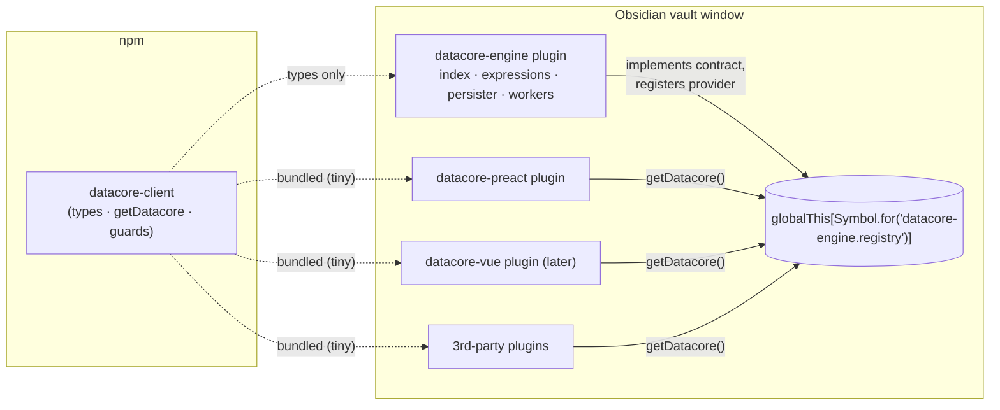

# Engine Room — Datacore as a Shared Query Engine

| | |
|---|---|
| **Status** | Draft (brainstorm output, v0.1) |
| **Date** | 2026-11-08 |
| **Owner** | Ken Snyder |
| **Fork** | `yankeeinlondon/datacore` (from `blacksmithgu/datacore` @ v0.1.28) |
| **Related** | `features/2026-11-08-frontend/` (Vue UI, later phase), `features/2026-11-08-active-prs/` |

## 1. Summary

Split Datacore into a **headless query engine** that runs once per vault, plus **UI layers and third-party plugins that consume it** through a small, versioned client package. Any number of Obsidian plugins can use Datacore's index, query language, and reactive updates while sharing **one** engine instance — one index, one cache, one worker pool, one event stream.

The repo becomes a monorepo with four packages:

| Package | Kind | Role |
|---|---|---|
| `datacore-client` | npm library | The API contract (types), the engine locator `getDatacore()`, and type guards. **The only thing consumers depend on.** |
| `datacore-engine` | Obsidian plugin | Indexing, persistence, expressions, queries, events. Implements the contract. No rendering. |
| `datacore-preact` | Obsidian plugin | Today's Preact UI (`datacorejs/jsx/ts/tsx` blocks, Table/List/Card/Callout, hooks), rebuilt as a consumer of `datacore-client`. |
| `datacore-vue` | Obsidian plugin | Future Vue UI. Starts with the same four views. **Out of scope for this spec beyond placeholders** (see `features/2026-11-08-frontend/`). |

## 2. Goals

1. **G1 — Engine/render separation.** The engine has no dependency on Preact, Vue, or any rendering code.
2. **G2 — Consumable package.** Other Obsidian plugins add `datacore-client` as a dependency and get a typed, documented, versioned API.
3. **G3 — Singleton at runtime.** However many plugins use Datacore, there is exactly one engine per vault window: one in-memory index, one IndexedDB cache, one worker pool, one event bus.
4. **G4 — Preact parity first.** Existing Datacore views and scripts keep working on top of the public API. That proves the API is sufficient before the Vue UI starts.
5. **G5 — Path to "embedded fallback."** The runtime protocol is designed so a future version can let a consumer start a bundled engine when no host plugin is installed (option C below) without breaking consumers.

## 3. Non-goals (for this spec)

- Building the Vue UI (only package scaffolding and contract requirements are captured here).
- Embedded-engine election / handoff (designed *for*, not built).
- Consumer-registered indexers or new `Indexable` types (designed *for*, deferred — see §11).
- Staying merge-compatible with upstream (see D3).
- Changing the query language or index data model.

## 4. Background & constraints

### 4.1 Obsidian plugin isolation

Each Obsidian plugin is a separately bundled `main.js` with its own module scope. Two plugins that both `import` a package get **two copies** of it. npm deduplication does not help. The only state shared between plugins is runtime state: `globalThis`/`window`, the `app` object (`app.plugins.plugins[id]`), the DOM, and IndexedDB (one origin).

Consequences:

- A singleton must be a **runtime rendezvous** on shared state, not a module-level singleton.
- **Class identity does not cross bundles.** If a consumer bundles its own `Link` or luxon `DateTime`, then `instanceof` checks on engine-produced objects fail. The engine relies on `instanceof` today (`Link` ×5, `DateTime` ×2, `Duration` ×2, `MarkdownListBlock`, `MarkdownPage`, `CanvasTextCard`, `DataArrayImpl`, …).

### 4.2 Current coupling (as of `1a83c5b`)

The engine core is already mostly render-free:

| Area | Finding | Resolution |
|---|---|---|
| `src/index/**`, `src/expression/**` | No Preact imports | Move as-is into `datacore-engine` |
| `api/result.ts` | Imported by engine modules (`datastore`, `query-executor`, `evaluator`, `binaryop`, `filters`, `embed-queue`, `edit/field`) | Move into engine core; re-export through the contract |
| `expression/binaryop.ts:192` | Reads view settings (`defaultDateFormat`, `defaultDateTimeFormat`, `renderNullAs`) to stringify values | Engine owns a separate *coercion format* setting; display formats move to UI settings |
| `api/data-array.ts`, `api/coerce.ts` | Pure utilities | Engine; exposed through the contract |
| `api/api.ts` | Mixes queries with `executeJs*` rendering and `get preact()` | Query half becomes the engine API; rendering half moves to `datacore-preact` |
| `api/local-api.tsx` | Mixes query methods, Preact hooks, and components; exposes `core` (internals) and `app` | Split: path-scoped query methods → contract; hooks/components → `datacore-preact` |
| `api/script-cache.ts` | Script loading (`dc.require`) imports Preact `h`/`Fragment` | Moves to `datacore-preact` (script execution is a UI concern) |
| `ui/hooks.tsx` | Reaches into `datacore.datastore.revision` and `datacore.on("update")` | Rebuilt on the contract's `revision` and `subscribe` |
| `settings.ts` | Mixes engine settings (importer threads/utilization, inline fields, list items) with view settings (paging, render depth, formats, `enableJs`) | Split into `EngineSettings` and per-UI settings |
| `main.ts` | Plugin registers codeblocks, CodeMirror modes, `window.datacore`, settings tab | Split between the engine plugin and `datacore-preact` |

### 4.3 Coexistence hazards with upstream Datacore

Users may have upstream Datacore installed next to this fork. Today these would collide:

- **`window.datacore`** global.
- **IndexedDB name** `datacore/cache/primary`. This name is also not vault-scoped. Whether IndexedDB is shared across vaults in Obsidian needs verifying; Dataview scopes its cache by `app.appId`.
- **Cache version thrash.** A cached entry is used only if `cached.version == core.version`, so two engines on different versions invalidate each other forever.
- **Codeblock languages** `datacorejs|jsx|ts|tsx` and their CodeMirror modes. Registering an already-registered language needs verifying; Obsidian likely throws.
- **Plugin id** `datacore`.

## 5. Decisions

| # | Decision | Status |
|---|---|---|
| D1 | **Singleton model: host plugin (option A).** The engine runs only in the `datacore-engine` plugin, and consumers locate it at runtime. The protocol must leave room for an embedded fallback (option C) later. | **Decided** |
| D2 | **Four-package monorepo:** `datacore-client`, `datacore-engine`, `datacore-preact`, `datacore-vue` (scaffold only). | **Decided** |
| D3 | **Hard fork.** Restructure freely; upstream fixes are ported by hand (cherry-pick with path rewriting). | Assumed (implied by D2) — confirm |
| D4 | **Contract-first.** `datacore-client` owns the API interfaces; `datacore-engine` `implements` them. Client semver = API version. | Proposed |
| D5 | **UIs are ordinary consumers.** `datacore-preact` (and later `datacore-vue`) may import only `datacore-client`, never engine internals. Enforced by package boundaries. | Proposed |
| D6 | **Distinct namespace** from upstream for plugin ids, globals, cache names, and codeblock languages (§8.4). | Proposed |
| D7 | **v1 API scope** = read/query/evaluate/subscribe + link/coerce/DataArray utilities + field writes. Custom expression functions in v1.x; custom indexers in v2. | Proposed — confirm |
| D8 | **Tooling:** pnpm workspaces, Vitest (migrate from Jest 27), TypeScript project references, esbuild for plugin bundles (Vite allowed for `datacore-vue`). | Proposed |

## 6. Architecture



Package dependency rules:

```
datacore-client   → (nothing at runtime; `obsidian` + `luxon` as type-only peer deps)
datacore-engine   → datacore-client (types), obsidian, luxon, parsimmon, localforage, …
datacore-preact   → datacore-client, preact, obsidian
datacore-vue      → datacore-client, vue, obsidian
```

`datacore-client` **must contain no runtime classes** of engine types. Runtime values (`Link`, luxon, `DataArray`) are obtained **from the engine instance**. This rule is what makes class identity safe (§7.4).

## 7. `datacore-client`: contract & runtime protocol

### 7.1 Locating the engine

```ts
import { getDatacore } from "datacore-client";

export default class MyPlugin extends Plugin {
  async onload() {
    const result = await getDatacore(this.app, {
      minApi: "1.0",        // semver range of the contract this plugin was built against
      timeoutMs: 10_000,    // wait for a host that hasn't loaded yet
      consumer: this,       // Component: scopes subscriptions + identifies the consumer
    });

    if (!result.ok) {
      // result.reason: "not-installed" | "disabled" | "incompatible" | "timeout"
      new Notice(`My Plugin needs Datacore Engine (${result.reason}).`);
      return;
    }

    const dc = result.engine;          // ScopedDatacore — auto-disposed when `this` unloads
    await dc.ready();                  // optional: wait for initial index
    console.log(dc.query("@page and #book").length);
  }
}
```

There's also a synchronous variant for callers that know the engine is present:

```ts
tryGetDatacore(app, opts): DatacoreHandle | undefined
```

### 7.2 Registry protocol (load-order independent)

Plugin load order is not guaranteed. Both sides use **get-or-create** on one shared registry object, so whichever loads first creates it:

```ts
const REGISTRY = Symbol.for("datacore-engine.registry");

interface EngineRegistry {
  /** Protocol version of the registry object itself (not the API). */
  protocol: 1;
  /** Engine providers; v1 only ever contains the host plugin. */
  providers: EngineProvider[];
  /** The provider currently serving consumers. */
  active?: EngineProvider;
  /** Consumers waiting for an active provider. */
  waiters: Set<(provider: EngineProvider) => void>;
  /** Notifies consumers that the active provider changed or went away. */
  listeners: Set<(event: ProviderEvent) => void>;
}

interface EngineProvider {
  kind: "host" | "embedded";      // "embedded" reserved for the future option C
  priority: number;                // host = 100; embedded fallback would be lower
  pluginId: string;
  engineVersion: string;           // e.g. "0.2.0"
  apiVersion: string;              // contract semver, e.g. "1.3.0"
  capabilities: ReadonlySet<string>; // e.g. "subscribe", "write", "functions"
  connect(consumer: ConsumerInfo): DatacoreHandle;
}

type ProviderEvent =
  | { type: "activated"; provider: EngineProvider }
  | { type: "deactivating"; provider: EngineProvider };
```

Lifecycle:

1. The engine plugin's `onload` registers its provider. If it has the highest priority, it becomes `active` and drains `waiters`.
2. The engine plugin's `onunload` emits `deactivating`, revokes every handle it issued, and removes itself.
3. A revoked handle throws `DatacoreRevokedError` on use. Consumers can listen with `handle.onRevoked(cb)`, and the client auto-reconnects when a provider activates again (opt-out via `reconnect: false`).

Why a `providers` list and `priority` in v1: option C only *adds* an `embedded` provider kind with lower priority, plus a handoff rule. Consumers don't change.

### 7.3 Versioning

- **`apiVersion`** is the semver of `datacore-client`'s contract. `getDatacore({ minApi })` fails with `incompatible` if the host's major differs or its minor is too low.
- **`capabilities`** gate optional features within a major (`dc.has("write")`), so consumers can degrade gracefully.
- **`engineVersion`** is informational (diagnostics, cache keys).
- The contract follows strict semver: additive changes are minor, and removing or changing an existing contract member is a major bump.

### 7.4 Class identity & type guards

- Indexables are identified **structurally** via `$types` / `$typename`, which already exist on every `Indexable`. Guards: `isIndexable`, `isMarkdownPage`, `isSection`, `isBlock`, `isListItem`, `isTask`, `isCanvas`, … all check `$types`.
- **Links:** the engine's `Link` gets a brand (`Symbol.for("datacore.link")`). `isLink(x)` checks the brand. Construction always goes through the engine (`dc.fileLink()`, `dc.parseLink()`, `dc.Link`).
- **Dates/durations:** guards use luxon's cross-copy-safe `DateTime.isDateTime` / `Duration.isDuration`. The engine exposes its luxon instance as `dc.luxon`. Consumers that bundle their own luxon can still read engine `DateTime`s but should create values via `dc.luxon`.
- **`DataArray`:** branded the same way. `dc.array()` constructs it.
- **Engine-internal `instanceof`:** remains valid inside the engine because there is only one engine copy. Any engine `instanceof` that might see consumer-created values (for example `Link` in expression evaluation, or values passed to `setField`) must switch to brand/guard checks.

### 7.5 API surface (v1 sketch)

```ts
/** Global, path-independent engine API. */
interface DatacoreApi {
  readonly apiVersion: string;
  readonly engineVersion: string;
  has(capability: string): boolean;

  // Lifecycle / status
  readonly initialized: boolean;
  readonly revision: number;
  ready(): Promise<void>;
  status(): EngineStatus;                       // indexing progress, counts, timings

  // Lookups & queries
  page<T extends MarkdownPage = MarkdownPage>(path: string | Link): T | undefined;
  load(id: string): Indexable | undefined;
  query<T extends Indexable = Indexable>(q: string | IndexQuery): T[];
  tryQuery<T extends Indexable = Indexable>(q: string | IndexQuery): Result<T[], string>;
  fullquery<T extends Indexable = Indexable>(q: string | IndexQuery): SearchResult<T>;
  tryFullQuery<T extends Indexable = Indexable>(q: string | IndexQuery): Result<SearchResult<T>, string>;
  parseQuery(q: string): IndexQuery;
  tryParseQuery(q: string): Result<IndexQuery, string>;

  // Expressions
  evaluate(expr: string | Expression, vars?: Variables, sourcePath?: string): Literal;
  tryEvaluate(expr: string | Expression, vars?: Variables, sourcePath?: string): Result<Literal, string>;

  // Links & paths
  resolvePath(path: string | Link, sourcePath?: string): string;
  fileLink(path: string): Link;
  headerLink(path: string, header: string): Link;
  blockLink(path: string, block: string): Link;
  parseLink(text: string): Link;
  tryParseLink(text: string): Result<Link, string>;

  // Utilities (runtime values from the engine's own copies)
  readonly luxon: typeof import("luxon");
  readonly coerce: Coerce;
  array<T>(input: T[] | DataArray<T>): DataArray<T>;

  // Reactivity
  subscribe<T extends Indexable>(q: string | IndexQuery, cb: (results: T[], meta: SubscriptionMeta) => void, opts?: SubscribeOptions): Disposable;
  watchFile(path: string, cb: (value: Indexable | undefined) => void, opts?: SubscribeOptions): Disposable;
  onRevision(cb: (revision: number) => void, opts?: SubscribeOptions): Disposable;
  on(evt: "rename", cb: (newPath: string, oldPath: string) => void): Disposable;
  on(evt: "initialized", cb: () => void): Disposable;

  // Writes (capability "write")
  setField(target: Indexable, field: string, value: Literal): Promise<Result<null, string>>;

  // Path-scoped view of the API (replaces today's DatacoreLocalApi query half)
  local(sourcePath: string): DatacoreLocalQueryApi;

  // Admin
  reindex(): Promise<void>;
}

/** Returned by getDatacore when a consumer Component is given. */
interface ScopedDatacore extends DatacoreApi {
  readonly consumer: ConsumerInfo;
  onRevoked(cb: () => void): Disposable;
}
```

Explicitly **not** in the contract: `core`, `datastore`, `persister`, `importer`, `app` passthrough, `preact`, `executeJs*`, any component or hook.

### 7.6 Reactivity semantics

- `subscribe` calls `cb` once with the initial results, then again **only when the result set changes** (compared by `$id` + `$revision`), debounced (default 500 ms, matching today's hooks; `debounce: 0` = immediate).
- v1 implementation: re-run the query on each index revision and diff. Smarter incremental invalidation can come later behind the same API.
- Results are **immutable snapshots**. Consumers must not mutate them; UIs must not deep-proxy them. Vue uses `shallowRef`/`markRaw`.
- Every `Disposable` created through a `ScopedDatacore` is disposed automatically when the consumer's `Component` unloads or when the handle is revoked.

## 8. `datacore-engine` plugin

### 8.1 Contents

Everything in `src/index/**` and `src/expression/**`, plus `result`, `data-array`, `coerce`, `utils/*` (minus JS transpile helpers, which go to `datacore-preact`), the persister, the inline worker, and an `EngineApiImpl implements DatacoreApi`.

### 8.2 Engine settings & settings tab

```ts
interface EngineSettings {
  importerNumThreads: number;
  importerUtilization: number;
  indexInlineFields: boolean;
  indexListItems: boolean;
  /** Formats used when the *engine* stringifies values (e.g. string concatenation in expressions). */
  coercion: { dateFormat: string; dateTimeFormat: string; nullAs: string };
}
```

The settings tab also shows diagnostics: index status, the list of connected consumers (from `ConsumerInfo`), and a "reindex vault" command.

### 8.3 Persistence

- IndexedDB instance name: `datacore-engine/cache/${app.appId}` (vault-scoped; distinct from upstream).
- Cache entries are keyed by an **index schema version**, not the plugin version, so plugin releases that don't change the serialized format don't force a reindex.

### 8.4 Namespacing (D6)

| Thing | Upstream | This fork |
|---|---|---|
| Engine plugin id | `datacore` | `datacore-engine` (tbd) |
| Global | `window.datacore` | Registry symbol only; no `window` global from the engine |
| IndexedDB | `datacore/cache/primary` | `datacore-engine/cache/<appId>` |
| Codeblock langs | `datacorejs/jsx/ts/tsx` | Owned by `datacore-preact`; see §9.3 |

## 9. `datacore-preact` plugin

### 9.1 Scope

Today's UI, ported to consume `datacore-client` only:

- Codeblock processors and CodeMirror modes for JS/JSX/TS/TSX.
- `DatacoreLocalApi` for scripts. It wraps `ScopedDatacore.local(path)` and adds hooks (`useQuery`, `useFullQuery`, `useFile`, `useCurrentFile`, `useIndexUpdates`, `useInterning`, Preact hooks), components (`Table`, `List`, `Card`, `Callout`, `Stack`, `Group`, `Literal`, `Markdown`, `Link`, `LinkEmbed`, `SpanEmbed`, `Icon`, `Button`, `Textbox`, `Checkbox`, `Slider`, `Switch`, `VanillaSelect`, `embed`), and `dc.require` (script cache).
- View settings: paging, page size, scroll-on-page-change, max render depth, display date formats, `renderNullAs`, `enableJs`.

### 9.2 Parity requirements

- Every documented `dc.*` member that exists today keeps working in scripts, **except** `dc.core`, which exposes engine internals and is removed. `dc.app` stays, since it comes from the UI plugin's own `app` rather than the engine.
- Hooks keep their debounce semantics.
- A parity test vault, `fixtures/vault`, has example scripts covering each view and hook. Its rendered output is checked before and after the split.

### 9.3 Codeblock language collision

Open (Q2). Options: (a) keep `datacorejs…` and refuse to register them, with a notice, if upstream Datacore is enabled; (b) new languages (e.g. `dcjs…`) plus a setting to also claim `datacorejs…`; (c) keep the names and document that upstream and this fork are mutually exclusive.

## 10. Monorepo layout & tooling

```
datacore/
├── packages/
│   ├── datacore-client/    # src/, vitest, api-extractor → published d.ts
│   ├── datacore-engine/    # src/ (index, expression, …), esbuild + inline worker → main.js
│   ├── datacore-preact/    # src/ (ui, api/ui, local-api), esbuild → main.js + styles.css
│   └── datacore-vue/       # scaffold only (package.json, README, tsconfig)
├── docs/                   # existing Docusaurus site → workspace package
├── fixtures/vault/         # parity / integration test vault
├── features/               # specs (this file)
├── pnpm-workspace.yaml
├── tsconfig.base.json      # shared compiler options; project references per package
└── package.json            # root scripts: build, test, lint, dev (symlink plugins into fixtures vault)
```

- **Tests:** migrate Jest 27 to Vitest (17 existing test files, `jsdom` environment). Contract packages get **type tests** (`expectTypeOf`) as well as runtime tests.
- **Boundaries:** each UI package's `package.json` lists only `datacore-client` as a datacore dependency. Also add lint rules (`no-restricted-imports`) as a backstop.
- **API report:** keep `api-extractor` for `datacore-client` and fail CI on unreviewed contract changes.
- **Dev loop:** `pnpm dev` builds both plugins in watch mode into `fixtures/vault/.obsidian/plugins/*`.

## 11. Future work (designed for, not built)

### 11.1 Option C: embedded fallback

`datacore-client` would gain an optional `datacore-client/embedded` entry that bundles the engine. If no host provider activates within `timeoutMs`, the consumer registers an `embedded` provider (priority < host). Remaining design questions:

- Election among multiple embedded providers (highest `apiVersion`, then `engineVersion`).
- Handoff when the active embedded provider's plugin unloads. Rehydrating from the shared IndexedDB cache is cheap because the cache name and schema version are shared.
- What happens when a host installs while an embedded engine is serving: activate the host, revoke embedded handles, and let clients auto-reconnect.
- Where engine settings live without a host (read-only defaults).

### 11.2 Custom expression functions (v1.x)

`dc.functions.register("myplugin.score", impl)`. Names are namespaced by consumer id and unregistered automatically when the consumer unloads. If a query references a function whose plugin is gone, it yields a typed error value rather than throwing.

### 11.3 Custom indexers / types (v2)

Consumers register derived types or importers. Open problems: running consumer parse code inside the engine's worker (code-string workers vs main-thread importers), `$typename` collisions, and cached objects whose providing plugin is disabled.

## 12. Phased plan

| Phase | Outcome | Exit criteria |
|---|---|---|
| **P0 — Monorepo scaffold** | pnpm workspaces; current code moved into `datacore-engine` *unchanged* (still a single plugin with UI); Vitest migration | Build produces a working plugin identical in behavior; all existing tests pass under Vitest |
| **P1 — Contract & engine API** | `datacore-client` contract, guards, registry protocol; `EngineApiImpl`; settings split; namespaced cache; Preact removed from the engine | Engine package has no `preact` dependency; contract type tests + registry load-order tests pass |
| **P2 — `datacore-preact`** | UI moved into its own plugin, consuming only `datacore-client` | Parity vault renders identically; plugins work in either load order; disabling/re-enabling the engine recovers the UI |
| **P3 — Stabilize & publish** | `datacore-client@1.0.0` on npm; example third-party consumer in `fixtures/`; docs | External example plugin works against the published package; API report frozen |
| **P4 — `datacore-vue`** | Separate spec (`features/2026-11-08-frontend/`) | — |

## 13. Risks

| Risk | Mitigation |
|---|---|
| Users must install two plugins (engine + UI) | Clear "engine missing" notices from `getDatacore`; UI plugin settings link to the engine; option C later |
| Contract grows into a mirror of internals | Contract-first review via api-extractor; UIs restricted to the contract (D5) |
| Hidden `instanceof` on consumer-supplied values | Audit in P1 (§7.4); tests that pass "foreign" `Link`/`DateTime` copies into the engine |
| Breaking `dc.core` for existing scripts | Documented removal; parity vault catches other regressions |
| Losing upstream fixes (hard fork) | Track upstream in `features/*-active-prs`; port selectively |
| Subscription cost with many consumers (re-run every query per revision) | Debounce, shared result caching for identical queries, incremental invalidation later |

## 14. Open questions

1. **Q1 — Names.** npm scope and package names (`@<scope>/datacore-client`?), plugin ids (`datacore-engine`, `datacore-preact`?), and display names.
2. **Q2 — Codeblock languages.** Which option from §9.3?
3. **Q3 — v1 scope (D7).** Confirm field writes are in v1 and custom functions are v1.x.
4. **Q4 — `window.datacore`.** Should `datacore-preact` still publish a `window.datacore` global for back-compat with scripts and other plugins, given it collides with upstream?
5. **Q5 — Community plugin store.** Do we intend to publish these plugins to the Obsidian community list (this affects naming, review constraints, and the install story)?
6. **Q6 — Vue authoring model** (for the frontend spec): declarative blocks, Vue JSX/render functions, SFC templates, or a phased mix?
7. **Q7 — Verify:** whether Obsidian's IndexedDB is shared across vaults, and what happens on duplicate codeblock-language registration.
