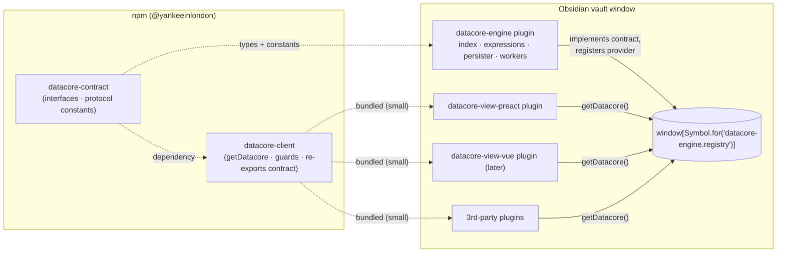

# Engine Room — Datacore as a Shared Query Engine

| | |
|---|---|
| **Status** | Approved; **P0 complete**, **P1 complete** (v0.5, 2026-11-11), **P2 planned**. See [p0-plan.md](./p0-plan.md#outcome-2026-11-11), [p1-plan.md](./p1-plan.md#outcome-2026-11-11), [p2-plan.md](./p2-plan.md) |
| **Date** | 2026-11-08 (updated 2026-11-11) |
| **Owner** | Ken Snyder |
| **Product** | **datacore-engine** ("Datacore Engine") |
| **Monorepo** | `yankeeinlondon/datacore` (hard fork of `blacksmithgu/datacore` @ v0.1.28) |
| **Baseline** | Tag `fork-baseline` on branch `pre-fork-upstream` (upstream `1a83c5b` + vetted upstream PRs) |
| **Related** | `features/2026-11-08-frontend/` (Vue views — later), [`features/2026-11-08-active-prs/evaluation.md`](../2026-11-08-active-prs/evaluation.md) |

## 1. Summary

Split Datacore into a **headless query engine** that runs once per vault, plus **view plugins and third-party plugins that consume it** through a small, versioned client package. Any number of Obsidian plugins can use Datacore's index, query language, and reactive updates while sharing **one** engine instance: one index, one cache, one worker pool, one event stream.

The repo becomes a pnpm monorepo with six packages:

| Package | Folder | Published | Ships as | Role |
|---|---|---|---|---|
| `@yankeeinlondon/datacore-contract` | `packages/contract` | npm | types + protocol constants | **The API contract**: interfaces, data shapes, registry protocol, events, capability names. Its semver *is* the API version. |
| `@yankeeinlondon/datacore-client` | `packages/client` | npm | consumer library | `getDatacore()` locator, scoping/reconnect, identity-safe guards and `Literals` helpers. Re-exports the contract. **The only package consumers install.** |
| `@yankeeinlondon/datacore-shared` | `packages/shared` | private | bundled | Pure functions and constants shared by the engine and the views. |
| `@yankeeinlondon/datacore-engine` | `packages/engine` | private | plugin **`datacore-engine`** | Indexing, persistence, expressions, queries, events. Implements the contract. No rendering. |
| `@yankeeinlondon/datacore-view-preact` | `packages/view-preact` | private | plugin **`datacore-view-preact`** | Today's Preact views and scripts, rebuilt as a consumer of the client. |
| `@yankeeinlondon/datacore-view-vue` | `packages/view-vue` | private | plugin **`datacore-view-vue`** | Future Vue views. Scaffold only in this spec (see §9.5). |

## 2. Goals

1. **G1 — Engine/render separation.** The engine has no dependency on Preact, Vue, or any rendering code.
2. **G2 — Consumable package.** Other Obsidian plugins add `@yankeeinlondon/datacore-client` as a dependency and get a typed, documented, versioned API.
3. **G3 — Singleton at runtime.** However many plugins use the engine, there is exactly one engine per vault window: one in-memory index, one IndexedDB cache, one worker pool, one event bus.
4. **G4 — Preact parity first.** Existing Datacore views and scripts keep working on top of the public API (with a renamed codeblock language, §9.3). That proves the API is sufficient before the Vue views start.
5. **G5 — Path to "embedded fallback."** The runtime protocol is designed so a future version can let a consumer start a bundled engine when no host plugin is installed (option C) without breaking consumers.
6. **G6 — Store-ready.** Names, lint rules, and release mechanics satisfy Obsidian community-store requirements from day one (D1).

## 3. Non-goals (for this spec)

- Building the Vue views (only scaffold and constraints, §9.5).
- Embedded-engine election and handoff (designed *for*, not built, §11.1).
- Field writes, custom expression functions, and custom indexers (reserved for 1.1 / 1.2 / 2.0, §11).
- Staying merge-compatible with upstream (D3).
- Changing the query language or index data model.
- Migrating the docs site off Docusaurus.

## 4. Background & constraints

### 4.1 Obsidian plugin isolation

Each Obsidian plugin is a separately bundled `main.js` with its own module scope. Two plugins that both `import` a package get **two copies** of it; npm deduplication does not help. The only state shared between plugins is runtime state: `globalThis`/`window`, the `app` object (`app.plugins.plugins[id]`), the DOM, and IndexedDB (one origin).

Consequences:

- A singleton must be a **runtime rendezvous** on shared state, not a module-level singleton.
- **Class identity does not cross bundles.** If a consumer bundles its own `Link` or luxon `DateTime`, then `instanceof` checks on engine-produced objects fail. The engine relies on `instanceof` today (`Link` ×5, `DateTime` ×2, `Duration` ×2, `MarkdownListBlock`, `MarkdownPage`, `CanvasTextCard`, `DataArrayImpl`, …), and so do the UI's value helpers (`Literals.*`).

### 4.2 Current coupling (as of `fork-baseline`)

The engine core is already mostly render-free:

| Area | Finding | Resolution |
|---|---|---|
| `src/index/**`, `src/expression/**` | No Preact imports | Move as-is into `engine` |
| `api/result.ts` | Imported by engine modules (`datastore`, `query-executor`, `evaluator`, `binaryop`, `filters`, `embed-queue`, `edit/field`) | `Result` *type* in contract; implementation in engine (and exposed via client helpers as needed) |
| `expression/binaryop.ts:192` | Reads the date formats and `renderNullAs` to stringify values | These become engine-owned **display defaults** (§8.2), used by the engine for stringification and shared with every view |
| `api/data-array.ts`, `api/coerce.ts` | Pure utilities | Engine; exposed through the contract (`dc.array`, `dc.coerce`) |
| `api/api.ts` | Mixes queries with `executeJs*` rendering and `get preact()` | Query half becomes the engine API; rendering half moves to `view-preact` |
| `api/local-api.tsx` | Mixes query methods, Preact hooks, and components; exposes `core` (internals) and `app` | Split: path-scoped query methods → contract (`local(path)`); hooks/components → `view-preact` |
| `api/script-cache.ts` | Script loading (`dc.require`) imports Preact `h`/`Fragment` | Moves to `view-preact`; later the shared module loader (§11.4) |
| `ui/hooks.tsx` | Reaches into `datacore.datastore.revision` and `datacore.on("update")` | Rebuilt on the contract's `revision` and `subscribe` |
| `settings.ts` | Mixes engine settings (importer threads/utilization, inline fields, list items) with presentation settings (paging, render depth, formats) and `enableJs` | `EngineSettings` = indexing + **display defaults** (one tab, owned by the engine); only plugin-specific options (e.g. `enableJs`) stay with a view plugin (§8.2) |
| `main.ts` | Registers codeblocks, CodeMirror modes, `window.datacore`, settings tab | Split between the engine plugin and `view-preact` |
| `LoadingProgress` (`ui/loading-boundary.tsx`) | Reads `datacore.initializer.progress()` for its initial render (events carry the payload since #184) | Contract `status()` supplies the initial progress |
| UI imports of `Literals.*` (8 files) | Runtime helpers with `instanceof` checks | Identity-safe replacements in the **client** (D7) |
| UI imports of `utils/normalizers`, `utils/media`, `utils/deferred` | Pure functions | Move to **`shared`** (D7) |
| `index/edit/field.ts` (`editProvenance`, `editInlineField`) | Unused and untested | Stays in the engine, not exposed until writes ship in 1.1 (D6) |

### 4.2.1 Obsidian runtime dependencies inside the engine

These make engine code impossible to test, or to run outside Obsidian, without shims:

- **Prototype extensions.** The datastore relies on Obsidian's `Array.prototype.contains`, and the initializer uses `Array.prototype.remove` (`this.current.remove(file)`). Tests currently polyfill `contains` (`src/test/index/datastore-revision.test.ts`).
- **Runtime `obsidian` imports.** `index/storage/folder.ts` imports `TFile`/`TFolder` for `instanceof` checks. The `obsidian` npm package ships types only, so tests need a virtual mock.

Requirements:

- **P0:** a shared engine test setup (an `obsidian` shim module plus prototype polyfills) wired through Vitest `setupFiles`.
- **P1:** replace Obsidian prototype extensions in engine code with standard methods (`includes`, `splice`).
- Client guards and `shared` code never depend on Obsidian prototype extensions (`$types.includes`, not `$types.contains`).

### 4.3 Coexistence with upstream Datacore

Users may have upstream Datacore (`datacore`) installed alongside these plugins. By design nothing collides (D2–D5):

| Surface | Upstream | This project |
|---|---|---|
| Plugin ids | `datacore` | `datacore-engine`, `datacore-view-preact`, `datacore-view-vue` |
| Global | `window.datacore` | `window.dc` (engine API; §8.5) |
| IndexedDB | `datacore/cache/primary` | `datacore-engine/cache/<appId>` |
| Codeblock languages | `datacorejs`, `datacorejsx`, `datacorets`, `datacoretsx` | `dc`, `dcx`, `dct`, `dctx` (§9.3) |
| Registry | — | `window[Symbol.for("datacore-engine.registry")]` |

Still to verify (P1/P2): whether Obsidian's IndexedDB is shared across vaults (the cache name is vault-scoped either way), and what Obsidian does on duplicate codeblock-language registration (now only relevant for defensive coding).

## 5. Decisions

All decisions are closed.

| # | Decision | Detail |
|---|---|---|
| D1 | **Singleton model: host plugin (option A).** | The engine runs only in the `datacore-engine` plugin; consumers locate it at runtime. The protocol leaves room for an embedded fallback (option C) later (§11.1). |
| D2 | **Distribution: BRAT → community store.** | Ship via BRAT first, then submit to the community store. Obsidian assumes one plugin per repo (root `manifest.json` + releases), so each plugin publishes to its own **release repo** from the monorepo via CI (§10.4). Names and lint follow store rules from day one. |
| D3 | **Hard fork.** | Restructure freely; upstream fixes are ported by hand. Open upstream PRs were triaged and the worthwhile ones merged before the fork (`fork-baseline`). |
| D4 | **Names.** | Product **datacore-engine**; npm scope **`@yankeeinlondon`**; packages and plugin ids per §1 and §8.4. Monorepo stays `yankeeinlondon/datacore` (keeps the GitHub fork link and attribution). |
| D5 | **Codeblock languages: new names only.** | `dc` (js), `dct` (ts), `dcx` (jsx), `dctx` (tsx), owned by `datacore-view-preact`. Never registers upstream's `datacore*` languages. A migration command converts `datacore*` fences (§9.3). |
| D6 | **Global: `window.dc`.** | The engine defines `window.dc` (engine API) as a read-only getter; never overwrites a foreign `window.dc` (§8.5). The view plugins put nothing on `window`. |
| D7 | **v1 API scope: core read + reactive only.** | Writes (`setField`, capability `write`) in 1.1; custom functions (`functions`, capability `functions`) in 1.2; custom indexers in 2.0. Names and capability flags are reserved now. |
| D8 | **Contract-first, in its own package.** | `datacore-contract` defines the API (types + protocol constants). The engine's classes `implements` the contract interfaces. `datacore-client` depends on the contract (caret range) and re-exports it; consumers install the client only. |
| D9 | **Import boundaries + `shared`.** | View packages depend on `client` + `shared`, never `engine` (pnpm isolation + `no-restricted-imports`). Identity-safe value helpers live in the client (public); pure utilities live in private `shared`: pure functions and constants only, no classes, no state, no runtime `obsidian`. |
| D10 | **Tooling.** | pnpm workspaces; Node 22 LTS; TypeScript 5.x (strict in contract/client/shared) with a shared base config and per-package typechecking; Vitest; esbuild (plugins) / Vite (view-vue); tsdown (contract, client) + api-extractor; **oxlint** (type-aware) + a minimal ESLint for type-aware Obsidian rules + **oxfmt**; **Changesets for all packages**; Docusaurus as a workspace package (§10). |
| D11 | **Vue authoring model: deferred** to the frontend spec, under three constraints (§9.5). | |

## 6. Architecture



Package dependency graph (workspace packages):

```
datacore-contract     → (no runtime deps; `obsidian`/`luxon` as type-only peers)
datacore-client       → datacore-contract
datacore-shared       → datacore-contract (types)
datacore-engine       → datacore-contract, datacore-shared, obsidian, luxon, parsimmon, localforage, …
datacore-view-preact  → datacore-client, datacore-shared, preact, obsidian
datacore-view-vue     → datacore-client, datacore-shared, vue, obsidian
```

Rules:

- **No runtime classes of engine types outside the engine.** Runtime values (`Link`, luxon, `DataArray`) come **from the engine instance**. This is what makes class identity safe (§7.4).
- `shared` holds pure functions and constants only: no classes, no state, no runtime `obsidian`.
- The views never import `datacore-engine`. Enforced structurally by pnpm (undeclared dependencies don't resolve) and by oxlint `no-restricted-imports`.

## 7. Contract & client

### 7.1 Locating the engine

```ts
import { getDatacore } from "@yankeeinlondon/datacore-client";

export default class MyPlugin extends Plugin {
  async onload() {
    const result = await getDatacore(this.app, {
      minApi: "1.0",        // contract (API) version this plugin was built against
      timeoutMs: 10_000,    // wait for a host that hasn't loaded yet
      consumer: this,       // Component: scopes subscriptions + identifies the consumer
    });

    if (!result.ok) {
      // result.reason: "not-installed" | "disabled" | "incompatible" | "timeout"
      new Notice(`My Plugin needs Datacore Engine (${result.reason}).`);
      return;
    }

    const dc = result.engine;          // ScopedDatacore: auto-disposed when `this` unloads
    await dc.ready();                  // optional: wait for the initial index
    console.log(dc.query("@page and #book").length);
  }
}
```

There is also a synchronous variant: `tryGetDatacore(app, opts): ScopedDatacore | undefined`.

`not-installed` vs `disabled` is determined from `app.plugins.manifests["datacore-engine"]` and `app.plugins.enabledPlugins`, so the engine's plugin id is part of the client contract and must never change.

### 7.2 Registry protocol (load-order independent)

Plugin load order is not guaranteed. Both sides use **get-or-create** on one shared registry object, so whichever loads first creates it. The symbol key and protocol types live in `datacore-contract`.

The registry lives on the main `window` (not `globalThis`): in Obsidian's renderer they are the same object, but Obsidian's guidelines (`obsidianmd/no-global-this`) require `window`/`activeWindow`. It must be the **main** `window`, never `activeWindow`, so popout windows share the one registry.

```ts
const REGISTRY = Symbol.for("datacore-engine.registry");

interface EngineRegistry {
  /** Protocol version of the registry object itself (not the API). */
  protocol: 1;
  /** Engine providers; v1 only ever contains the host plugin. */
  providers: EngineProvider[];
  /** The provider currently serving consumers. */
  active?: EngineProvider;
  /** Consumers waiting for an active provider. */
  waiters: Set<(provider: EngineProvider) => void>;
  /** Notifies consumers that the active provider changed or went away. */
  listeners: Set<(event: ProviderEvent) => void>;
}

interface EngineProvider {
  kind: "host" | "embedded";      // "embedded" reserved for option C
  priority: number;                // host = 100; an embedded fallback would be lower
  pluginId: string;                // "datacore-engine"
  engineVersion: string;           // engine package version
  apiVersion: string;              // contract version the engine was built against (stamped at build time)
  capabilities: ReadonlySet<string>;
  connect(consumer: ConsumerInfo): ScopedDatacore;
}

type ProviderEvent =
  | { type: "activated"; provider: EngineProvider }
  | { type: "deactivating"; provider: EngineProvider };
```

Lifecycle:

1. The engine plugin's `onload` registers its provider. If it has the highest priority, it becomes `active` and drains `waiters`.
2. The engine plugin's `onunload` emits `deactivating`, revokes every handle it issued, and removes itself.
3. A revoked handle throws `DatacoreRevokedError` on use. Consumers can listen with `handle.onRevoked(cb)`, and the client auto-reconnects when a provider activates again (opt-out via `reconnect: false`).

A `providers` list and `priority` exist in v1 so that option C only *adds* an `embedded` provider kind with lower priority, plus a handoff rule. Consumers don't change.

### 7.3 Versioning

- **`apiVersion`** = the `datacore-contract` package version. `getDatacore({ minApi })` fails with `incompatible` if the host's major differs or its minor is too low. The engine stamps `apiVersion` at build time from the contract's `package.json`.
- **`capabilities`** gate optional features within a major (`dc.has("write")`). v1.0 advertises the core capabilities only; `write` (1.1) and `functions` (1.2) are reserved names.
- **`engineVersion`** is informational (diagnostics).
- The contract follows strict semver: additive changes are minor; removing or changing a member is major. The contract starts at `0.x` and goes to `1.0.0` at P3.
- **The client** has its own version. Locator and helper fixes are client patches and do not change the API version. The client depends on the contract with a caret range and re-exports it. Consumers must not depend on `datacore-contract` directly (duplicate copies would split `unique symbol` brand types), unless they are *implementing* the contract.

### 7.4 Class identity & type guards

- **Indexables** are identified **structurally** via `$types` / `$typename`, which exist on every `Indexable`. Client guards `isIndexable`, `isMarkdownPage`, `isSection`, `isBlock`, `isListItem`, `isTask`, `isCanvas`, … check `$types.includes(...)`.
- **Links:** the engine's `Link` carries a brand (`Symbol.for("datacore.link")`; the key is a contract constant). `isLink(x)` checks the brand. Construction always goes through the engine (`dc.fileLink()`, `dc.parseLink()`, …).
- **Dates/durations:** guards use luxon's cross-copy-safe `DateTime.isDateTime` / `Duration.isDuration`. The engine exposes its luxon instance as `dc.luxon`.
- **`DataArray`:** branded the same way; `dc.array()` constructs it.
- **Value helpers:** the client provides identity-safe replacements for the UI's `Literals.*` (`typeOf`, `isLink`, `isDate`, `compare`, grouping helpers) built on the guards above. These are public API, useful to every consumer.
- **Engine-internal `instanceof`** remains valid inside the engine (there is only one engine copy). Any engine `instanceof` that can see consumer-created values (e.g. a `Link` passed into `evaluate` variables) switches to brand/guard checks. Audited in P1.

### 7.5 API surface (v1 sketch)

```ts
/** Global, path-independent engine API. */
interface DatacoreApi {
  readonly apiVersion: string;
  readonly engineVersion: string;
  has(capability: string): boolean;

  // Lifecycle / status
  readonly initialized: boolean;
  readonly revision: number;
  ready(): Promise<void>;
  status(): EngineStatus;                       // { initialized, progress: IndexProgress, counts, timings }

  // Lookups & queries
  page<T extends MarkdownPage = MarkdownPage>(path: string | Link): T | undefined;
  load(id: string): Indexable | undefined;
  query<T extends Indexable = Indexable>(q: string | IndexQuery): T[];
  tryQuery<T extends Indexable = Indexable>(q: string | IndexQuery): Result<T[], string>;
  fullquery<T extends Indexable = Indexable>(q: string | IndexQuery): SearchResult<T>;
  tryFullQuery<T extends Indexable = Indexable>(q: string | IndexQuery): Result<SearchResult<T>, string>;
  parseQuery(q: string): IndexQuery;
  tryParseQuery(q: string): Result<IndexQuery, string>;

  // Expressions
  evaluate(expr: string | Expression, vars?: Variables, sourcePath?: string): Literal;
  tryEvaluate(expr: string | Expression, vars?: Variables, sourcePath?: string): Result<Literal, string>;

  // Links & paths
  resolveLink(link: string | Link, sourcePath?: string): Indexable | undefined; // file, section, or block
  resolvePath(path: string | Link, sourcePath?: string): string;
  fileLink(path: string): Link;
  headerLink(path: string, header: string): Link;
  blockLink(path: string, block: string): Link;
  parseLink(text: string): Link;
  tryParseLink(text: string): Result<Link, string>;

  // Utilities (runtime values from the engine's own copies)
  readonly luxon: typeof import("luxon");
  readonly coerce: Coerce;
  array<T>(input: T[] | DataArray<T>): DataArray<T>;

  // Reactivity
  subscribe<T extends Indexable>(q: string | IndexQuery, cb: (results: T[], meta: SubscriptionMeta) => void, opts?: SubscribeOptions): Disposable;
  watchFile(path: string, cb: (value: Indexable | undefined) => void, opts?: SubscribeOptions): Disposable;
  onRevision(cb: (revision: number) => void, opts?: SubscribeOptions): Disposable;
  on(evt: "rename", cb: (newPath: string, oldPath: string) => void): Disposable;
  on(evt: "initialized", cb: () => void): Disposable;
  on(evt: "index-progress", cb: (progress: IndexProgress) => void): Disposable; // { initialized, total }
  on(evt: "display-settings", cb: (display: DisplaySettings) => void): Disposable;

  // Shared presentation preferences, owned by the engine's settings tab (read-only for consumers; §8.2)
  readonly settings: { readonly display: DisplaySettings };

  // Path-scoped view of the API (replaces today's DatacoreLocalApi query half)
  local(sourcePath: string): DatacoreLocalQueryApi;

  // Admin
  reindex(): Promise<void>;

  // Reserved, not in 1.0 (D7):
  //   setField(...)  — capability "write"      (1.1)
  //   functions      — capability "functions"  (1.2)
}

/** Returned by getDatacore when a consumer Component is given. */
interface ScopedDatacore extends DatacoreApi {
  readonly consumer: ConsumerInfo;
  onRevoked(cb: () => void): Disposable;
}
```

Explicitly **not** in the contract: `core`, `datastore`, `persister`, `importer`, `app` passthrough, `preact`, `executeJs*`, any component or hook.

### 7.6 Reactivity semantics

- `subscribe` calls `cb` once with the initial results, then again **only when the result set changes** (compared by `$id` + `$revision`), debounced (default 500 ms, matching today's hooks; `debounce: 0` = immediate).
- v1 implementation: re-run the query on each index revision and diff. Smarter incremental invalidation can come later behind the same API.
- Results are **immutable snapshots**. Consumers must not mutate them; views must not deep-proxy them (Vue uses `shallowRef`/`markRaw`).
- Every `Disposable` created through a `ScopedDatacore` is disposed automatically when the consumer's `Component` unloads or when the handle is revoked.
- **Revision rule (contract guarantee).** `revision` increases monotonically. Every object stored in revision *N* carries `$revision === N`, and immediately after a store, `revision === N`. Deletes, `touch()` and `clear()` bump the revision without stamping any object. Established by upstream #180 and pinned by `datastore-revision.test.ts`, which becomes a contract test.
- **Index progress.** During the initial index, the engine emits `index-progress` with `{ initialized, total }`, at least every 32 files and once on completion, yielding to the renderer between batches (#184). Views read progress only from this event or `status()`.
- **High-frequency UI state never bumps the index revision.** Access times, recent files, selection, focus, etc. live in separate stores with their own events, never in indexed objects (lesson from upstream #87).

## 8. `datacore-engine` plugin

### 8.1 Contents

Everything in `src/index/**` and `src/expression/**`, plus `Result`, `DataArray`, `Coerce`, the persister, the inline worker, and an `EngineApiImpl implements DatacoreApi`. Pure helpers it shares with the views come from `shared`.

### 8.2 Settings: one tab, owned by the engine

Obsidian gives each plugin its own settings tab, and plugins cannot contribute sections to another plugin's tab. Rather
than build a cross-plugin settings API, **the engine's tab is the single settings tab** for the whole family. It holds
indexing options plus **display defaults** that every view plugin (Preact, Vue, third parties) reads through the
contract, so users set things like the date format once.

```ts
interface EngineSettings {
  // Indexing
  importerNumThreads: number;
  importerUtilization: number;
  indexInlineFields: boolean;
  indexListItems: boolean;
  /** Presentation defaults shared by all views; also used by the engine when stringifying values in expressions. */
  display: DisplaySettings;
}

/** Contract type; exposed read-only as `dc.settings.display`, with a `display-settings` change event. */
interface DisplaySettings {
  dateFormat: string;          // luxon format
  dateTimeFormat: string;      // luxon format
  nullAs: string;              // how empty values render
  pagingEnabled: boolean;      // views page results by default
  pageSize: number;            // default rows per page
  scrollOnPageChange: boolean;
  maxRecursiveRenderDepth: number;
}
```

- The tab also shows diagnostics: index status, connected consumers (from `ConsumerInfo`), and a "Reindex vault"
  action.
- **View plugins keep only plugin-specific options.** For `datacore-view-preact` that is essentially "Enable
  JavaScript views". If a view plugin's options are this small, it may expose them as commands or a single toggle
  instead of its own tab.
- Views re-render on `display-settings` changes.

### 8.3 Persistence

- IndexedDB instance name: `datacore-engine/cache/${app.appId}` (vault-scoped; distinct from upstream).
- Cache entries are keyed by an **index schema version**, not the plugin version, so releases that don't change the serialized format don't force a reindex.

### 8.4 Identity & namespacing

| Thing | Value |
|---|---|
| Plugin id / display name | `datacore-engine` / "Datacore Engine" |
| Release repo | `yankeeinlondon/datacore-engine` |
| Registry | `window[Symbol.for("datacore-engine.registry")]` |
| Global | `window.dc` (§8.5) |
| IndexedDB | `datacore-engine/cache/<appId>` |
| Workspace events | `datacore-engine:*` |
| Manifest | author Ken Snyder; `minAppVersion` and `isDesktopOnly: false` carried from upstream |

### 8.5 `window.dc`

- Defined by the engine via `Object.defineProperty(window, "dc", { get, configurable: true })`: a **read-only getter** returning the current engine API (`DatacoreApi`), or `undefined` while the engine is unloaded. A stale reference never outlives a disable/enable cycle.
- **Never clobbers:** if `window.dc` is already defined by something else (e.g. the dc.js charting library), the engine logs a warning and skips the global. The registry and `getDatacore()` are unaffected.
- Removed on unload.
- Subscriptions created through `window.dc` are **not** consumer-scoped (no auto-dispose); documented as "for scripts, Templater/QuickAdd and the console, not plugins". Plugins use `getDatacore()`.
- Typing: `datacore-client` ships `declare global { interface Window { dc?: DatacoreApi } }`.
- Inside view code blocks, the injected local `dc` (path-scoped, with hooks and components) **shadows** the global. Scripts always get the richer API; docs explain the difference.

## 9. View plugins

### 9.1 `datacore-view-preact`: scope

Today's UI, ported to consume `datacore-client` (+ `shared`) only:

- Codeblock processors and CodeMirror modes for `dc` / `dct` / `dcx` / `dctx` (§9.3).
- The script-facing local API: wraps `ScopedDatacore.local(path)` and adds hooks (`useQuery`, `useFullQuery`, `useFile`, `useCurrentFile`, `useIndexUpdates`, `useInterning`, Preact hooks), components (`Table`, `List`, `Card`, `Callout`, `Stack`, `Group`, `Literal`, `Markdown`, `Link`, `LinkEmbed`, `SpanEmbed`, `Icon`, `Button`, `Textbox`, `Checkbox`, `Slider`, `Switch`, `VanillaSelect`, `embed`), and `dc.require` (script cache, with `__filename`/`__dirname` and host modules).
- Settings: only `enableJs` ("Enable JavaScript views"); all presentation defaults come from the engine via `dc.settings.display` (§8.2).
- Identity: plugin id `datacore-view-preact`, display name "Datacore View: Preact", release repo `yankeeinlondon/datacore-view-preact`.

### 9.2 Parity requirements

- Every documented `dc.*` member that exists today keeps working in scripts, **except** `dc.core` (engine internals; removed). `dc.app` stays (the view plugin's own `app`).
- Hooks keep their debounce semantics.
- A parity test vault, `fixtures/vault`, has example scripts covering each view and hook. Its rendered output is checked before and after the split.

### 9.3 Codeblock languages (D5)

| Language | Script type |
|---|---|
| `dc` | JavaScript |
| `dct` | TypeScript |
| `dcx` | JSX |
| `dctx` | TSX |

- `datacore-view-preact` registers only these, never upstream's `datacore*` languages, so it can run side by side with upstream Datacore.
- **Migration command:** "Convert `datacore*` code blocks to `dc*`". It scans the vault, previews the affected notes and counts, then rewrites the fence info strings (`datacorejs→dc`, `datacorets→dct`, `datacorejsx→dcx`, `datacoretsx→dctx`).
- These short names are bound to the Preact views. The Vue views get their own language family (§9.5).

### 9.4 `datacore-view-vue`: scaffold

In this spec: package, tsconfig, Vite config stub, manifest (`datacore-view-vue`, "Datacore View: Vue", release repo `yankeeinlondon/datacore-view-vue`), README. No behaviour.

### 9.5 Vue constraints (D11)

The Vue authoring model (declarative blocks, render functions/JSX, SFC templates, or a phased mix) is decided in `features/2026-11-08-frontend/`. Until then, P0–P3 must preserve these constraints:

1. **Framework-neutral contract:** reactivity is plain callbacks + `Disposable`s over immutable snapshots.
2. **Injected framework binding:** the shared script/module loader (§11.4) takes `h`/`Fragment` (or Vue's `h`) as an input; nothing hard-codes Preact.
3. **Separate codeblock family:** Vue views use their own languages (e.g. `dcv`/`dcvt`/`dcvx`/`dcvtx`, or a declarative `dcview`), decided with the authoring model.

## 10. Monorepo layout & tooling

### 10.1 Layout

```
datacore/
├── packages/
│   ├── contract/        # @yankeeinlondon/datacore-contract  (tsdown → ESM + d.ts; api-extractor)
│   ├── client/          # @yankeeinlondon/datacore-client    (tsdown → ESM + d.ts; api-extractor)
│   ├── shared/          # @yankeeinlondon/datacore-shared    (private; source-only, bundled by consumers)
│   ├── engine/          # @yankeeinlondon/datacore-engine    (esbuild + inline worker → plugin)
│   ├── view-preact/     # @yankeeinlondon/datacore-view-preact (esbuild → plugin)
│   └── view-vue/        # @yankeeinlondon/datacore-view-vue  (scaffold; Vite later)
├── docs/                # Docusaurus site (workspace package)
├── fixtures/vault/      # parity / integration test vault
├── features/            # specs
├── scripts/             # release helpers (manifest sync, …)
├── .changeset/
├── pnpm-workspace.yaml
├── tsconfig.base.json   # shared options; each package extends it and typechecks with tsc --noEmit
├── tsconfig.json        # root-level and package config files (keeps type-aware tooling inside the repo)
├── .oxlintrc.json
├── .oxfmtrc.json        # migrated from .prettierrc
└── package.json         # root scripts: build, test, lint, fmt, typecheck, dev, release
```

### 10.2 Tooling (D10)

| Area | Choice | Notes |
|---|---|---|
| Package manager / runtime | **pnpm** workspaces (pinned via `packageManager`); **Node 22 LTS** (`.nvmrc`, `engines`) | pnpm's isolated `node_modules` enforces D9 |
| TypeScript | **5.9.3** (latest 5.x); `strict: true` in contract, client, shared; engine keeps current flags (tightened later); per-package `tsc --noEmit`; workspace packages export `src` in development and `dist` via `publishConfig` | The engine's bare imports resolve via explicit relative `paths` (TypeScript 7-compatible). TypeScript 6/7 are available; moving to them is a future decision |
| Tests | **Vitest** (jsdom); shared setup file with `obsidian` shim + `contains`/`remove` polyfills; explicit aliases for the engine's bare imports; `expectTypeOf` type tests for contract/client | |
| Plugin bundling | **esbuild** (engine, view-preact); **Vite** for view-vue (later) | esbuild version upgrade happens separately from the restructure |
| Library builds | **tsdown** (contract, client): ESM + `.d.ts`, `exports` maps; **api-extractor** reports | CI fails on unreviewed contract changes |
| Lint | **oxlint** with `--type-aware` (oxlint-tsgolint): Vitest plugin, `no-restricted-imports` for boundaries, local `datacore/no-class` rule, and **`eslint-plugin-obsidianmd`'s untyped rules via `jsPlugins`**. **ESLint 10** (`eslint.config.mjs`) runs only obsidianmd's 7 type-aware rules plus manifest/license validation | oxlint's JS-plugin bridge provides no TypeScript program, so type-aware ESLint rules cannot run there |
| Format | **oxfmt**, config migrated from `.prettierrc` (`oxfmt --migrate=prettier`): 4 spaces, width 120, ES5 trailing commas, double quotes | One isolated reformat commit, listed in `.git-blame-ignore-revs` |
| Task running | pnpm recursive scripts (`pnpm -r`, `--filter`) | Add Turbo only if builds get slow |
| Versioning | **Changesets for all packages** (`privatePackages: { version: true, tag: true }`; `docs` ignored; internal dependency bumps on) | §10.4 |
| Docs | Docusaurus as a workspace package | Migration off Docusaurus is out of scope |

### 10.3 Boundaries & checks

- Views list only `@yankeeinlondon/datacore-client` and `@yankeeinlondon/datacore-shared` as datacore dependencies; oxlint `no-restricted-imports` blocks any `@yankeeinlondon/datacore-engine` import from view packages.
- `shared`: lint forbids `class` declarations and runtime `obsidian` imports.
- CI: `pnpm -r typecheck`, `pnpm -r test`, `pnpm lint`, `pnpm fmt --check`, api-extractor reports, plugin builds.

### 10.4 Releases

- **Changesets** versions every package; private plugin packages get git tags (e.g. `@yankeeinlondon/datacore-engine@1.2.0`).
- A post-`changeset version` script syncs each plugin's `manifest.json` (`version`) and `versions.json` (`version → minAppVersion`) from its `package.json`.
- **npm:** `contract` and `client` publish via `changeset publish`.
- **Plugins:** a GitHub Action, triggered by a plugin package tag, builds the plugin and publishes a GitHub release tagged with the **bare version** (`1.2.0`, as Obsidian requires) to its release repo (`yankeeinlondon/datacore-engine`, `…/datacore-view-preact`, `…/datacore-view-vue`), with `main.js`, `manifest.json`, `styles.css`, and the root `manifest.json` updated.
- **BRAT phase:** Changesets pre-release mode (`changeset pre enter beta`) produces `x.y.z-beta.n` versions; exit pre mode for store releases.

## 11. Future work (designed for, not built)

### 11.1 Option C: embedded fallback

`datacore-client` would gain an optional `datacore-client/embedded` entry that bundles the engine. If no host provider activates within `timeoutMs`, the consumer registers an `embedded` provider (priority < host). Remaining design questions:

- Election among multiple embedded providers (highest `apiVersion`, then `engineVersion`).
- Handoff when the active embedded provider's plugin unloads. Rehydrating from the shared IndexedDB cache is cheap because the cache name and schema version are shared.
- What happens when a host is installed while an embedded engine is serving: activate the host, revoke embedded handles, clients auto-reconnect.
- Where engine settings live without a host (read-only defaults).

### 11.2 Field writes (1.1, capability `write`)

`setField(field, value)` edits the frontmatter key or inline field a value came from, using its `Provenance`. Needs its own small spec: stale-revision checks (`Provenance.revision`), tests against real note fixtures, error reporting. The existing `index/edit/field.ts` is the starting point.

### 11.3 Custom expression functions (1.2, capability `functions`)

`dc.functions.register("myplugin.score", impl)`. Names are namespaced by consumer id and unregistered automatically when the consumer unloads. A query referencing a function whose plugin is gone yields a typed error value rather than throwing.

### 11.4 Custom indexers / types (2.0)

Consumers register derived types or importers. Open problems: running consumer parse code inside the engine's worker (code-string workers vs main-thread importers), `$typename` collisions, and cached objects whose providing plugin is disabled.

### 11.5 Shared script / module loader (view packages)

A framework-agnostic loader used by both view plugins, superseding `ScriptCache`:

- **ES modules:** `import`/`export` via sucrase's imports transform with an injected async `require`; no regex rewriting (lesson from upstream #84).
- **Resolution owned by the loader:** script roots / import map, relative imports, extension inference. `Datastore.resolveLink` is not loosened for every caller.
- **Dependency graph** with cycle detection and invalidation when an imported file changes.
- **Script context:** `__filename` / `__dirname` (#150), host modules via the `isHostModule` allowlist (#181), `export default` views.
- **Framework binding injected** by the view package (§9.5).

### 11.6 Multi-value inline fields (engine)

Dataview-style semantics (a repeated key yields an array) as a single list map, with `$infields` derived from it or dropped; wired into `value()`/field extractors; cache schema version bump. Upstream #157 attempted this and was skipped.

### 11.7 Recent files store (engine)

A capped, persisted list of recently opened files with its own `recentFiles()` accessor and change event. Never touches indexed objects or the revision (§7.6).

## 12. Phased plan

| Phase | Outcome | Exit criteria |
|---|---|---|
| **P-1 — Fork baseline** ✅ | Upstream open PRs triaged ([evaluation](../2026-11-08-active-prs/evaluation.md)); #180, #184, #122, #150, #181 and fixes from #157/#87 merged on `pre-fork-upstream`, tagged `fork-baseline` | 345 tests pass; `tsc`, library build, api-extractor and plugin build pass |
| **P0 — Monorepo scaffold** ✅ | pnpm workspaces; current code moved into `packages/engine` *unchanged* (still a single plugin, including UI); Vitest; scaffolds for contract, client, shared, view-preact, view-vue; oxlint + oxfmt; Changesets; Docusaurus as a workspace package | Plugin build output behaves identically to `fork-baseline`; all 345 tests pass under Vitest; lint/format/typecheck clean; empty packages build |
| **P1 — Contract & engine API** ✅ | `datacore-contract` interfaces + constants; client (`getDatacore`, guards, value helpers); registry protocol; `EngineApiImpl`; settings split; namespaced cache; `window.dc`; Obsidian prototype extensions removed; UI rewired onto the contract API (Preact itself leaves the engine in P2; see p1-plan) | UI uses only the contract API (lint-enforced); contract type tests; registry load-order and revocation tests; api-extractor reports reviewed |
| **P2 — `datacore-view-preact`** | Views moved into their own plugin consuming only the client + shared; `dc`/`dct`/`dcx`/`dctx` languages; migration command | Parity vault renders identically; plugins work in either load order; disabling/re-enabling the engine recovers views; runs alongside upstream Datacore |
| **P3 — Stabilize & publish** | Contract and client `1.0.0` on npm; release CI to per-plugin release repos; BRAT betas; example third-party consumer in `fixtures/`; docs | External example plugin works against the published client; API report frozen; BRAT install works for both plugins |
| **P4 — Store submission** | Submit `datacore-engine` and `datacore-view-preact` to the community store | Accepted |
| **P5 — `datacore-view-vue`** | Separate spec (`features/2026-11-08-frontend/`) | — |

## 13. Risks

| Risk | Mitigation |
|---|---|
| Users must install two plugins (engine + views) | Clear "engine missing" notices from `getDatacore`; one settings tab (the engine's) for the whole family; option C later |
| Contract grows into a mirror of internals | Separate contract package, api-extractor review, views restricted to client (D8, D9) |
| Duplicate contract copies split brand types | Consumers install the client only; client re-exports the contract with a caret range (§7.3) |
| Hidden `instanceof` on consumer-supplied values | Audit in P1 (§7.4); tests that pass "foreign" `Link`/`DateTime` copies into the engine |
| Breaking changes for upstream users (`dc.core`, codeblock names) | Documented; migration command for code fences; parity vault catches other regressions |
| oxlint JS plugins are alpha | Untyped obsidianmd rules verified with positive controls; typed rules run in ESLint |
| Losing upstream fixes (hard fork) | Open PRs merged into `fork-baseline`; track later upstream work in `features/*-active-prs`; port selectively |
| Subscription cost with many consumers | Debounce, shared result caching for identical queries, incremental invalidation later |

## 14. Remaining verifications & follow-ups

Facts to confirm during implementation, and follow-ups to schedule:

1. Whether Obsidian's IndexedDB is shared across vaults (P1; the cache name is vault-scoped either way).
2. ~~Obsidian's behaviour on duplicate codeblock-language registration~~. Resolved in P2 (Obsidian 1.15.1): the
   second `registerMarkdownCodeBlockProcessor` for a language **throws** ("…is already registered") and the first
   registrant keeps it, but the post-processor Obsidian created before throwing is **never removed**, so it keeps
   rendering that language with the second plugin's handler until Obsidian restarts. `datacore-view-preact` therefore
   checks the (private) registry before registering each `dc*` language and skips taken ones with a warning.
3. ~~`eslint-plugin-obsidianmd` compatibility with oxlint `jsPlugins`~~. Resolved in P0: untyped rules work in oxlint; the 7 type-aware rules and manifest/license validation run in ESLint.
4. Whether to move to TypeScript 6/7 (7.0.2 is the latest release). Gated on api-extractor, tsdown d.ts generation, and typescript-eslint support.
